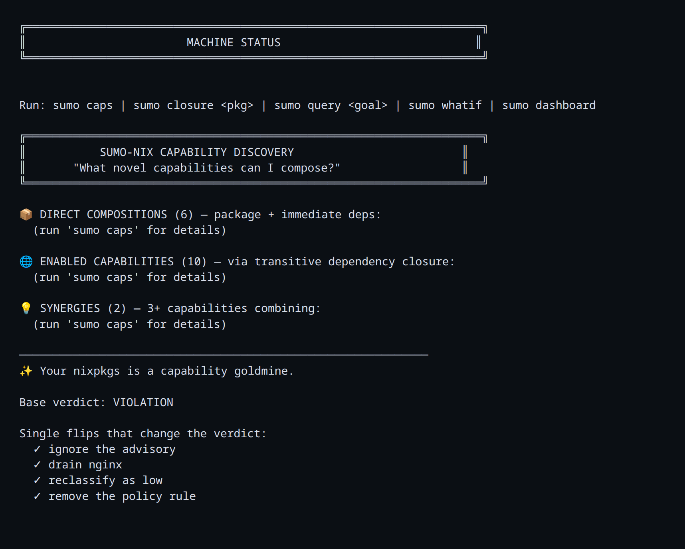

<!-- generated by tools/build-readme.sh; do not edit -->

# sumonix — a semantic OS for NixOS 🦙

> **Your configuration already declares the truth. sumonix makes it provable.**
>
> Audit-grade reasoning over machines, packages, and organizations — every ground verdict carries a proof that a separate checker can re-run.

<p align="center">
  
</p>

**sumonix turns declarations and observations into facts, reasons over them with Horn rules, and returns proofs.** Ask why a build fails, whether a CVE reaches production, or what must change to ship. You get an answer, a proof tree, and a ranked repair — not an opinion.

| | |
|---|---|
| 🚧 **Gate** | Policy violations stop the build with a proof-of-violation that names the exact option paths. |
| ✅ **Proof** | Every derived fact carries rule, round, bindings, and provenance. `proof-check.nix` shares zero code and rejects tampering. |
| 🔭 **Observe** | Declared config and live state become one source-labeled model; drift and rogue listeners are found, not guessed. |
| 🧭 **Repair** | Ranked single-option edits, each re-lifted and re-gated before a human applies it. |
| 🧩 **Extend** | SUMO declaration synthesis, a JSON ⇄ KIF adapter with YAML/TOML schema forms, policy packs, verified transitions, and 28 bootstraps. |
| ⚡ **Small** | Pure Nix: no daemon, no external solver, no LLM in the reasoning path. 27 tests green; warm runs are near-instant. |

**See the trust anchor in one command:**

```console
$ ./nix-eval.sh --expr '(import ./proof-check.nix { file = ./proof.kif; })'
"proof: 9 steps, independently re-checked ✓"
```

**Contents:** [Quick start](#quick-start) · [What it is](#what-it-is) · [Status](#status) · [Architecture](#architecture) · [CLI cheatsheet](#cli-cheatsheet) · [Extension contract](#extension-contract) · [Application bootstraps](#application-bootstraps) · [Coverage](#coverage) · [The demo](#the-demo) · [Metavisor live loop](#metavisor-live-loop) · [Repository layout](#repository-layout) · [Documentation map](#documentation-map)

## Quick start

### Try it in 60 seconds

```bash
git clone https://github.com/autonull/sumonix
cd sumonix

./run-tests.sh     # 27 tests, eval-only
./demo/run         # five scenes, ~30 seconds, offline facts committed
```

There is no install step for the repository checkout: `./bin/sumo` sources
`tools/env.sh`, points Nix at the repository-local store, and runs
`nix eval`. `nix develop` puts the packaged `sumo` CLI on `PATH`.

**Requirements:** Nix; enable flakes for `nix develop` and `nix run`.
Evaluation needs no root and no daemon. The container demo
(`./container/run.sh`) additionally needs unprivileged user namespaces; see
[Metavisor live loop](#metavisor-live-loop).

### Run the full proof loop

```bash
# 1. Derive, export a certificate, and re-check it independently.
./nix-eval.sh --raw --expr 'import ./tests/proof-artifact.nix' > proof.kif
./nix-eval.sh --expr '(import ./proof-check.nix { file = ./proof.kif; })'
# → "proof: 9 steps, independently re-checked ✓"

# 2. Ask the machine what it knows.
./bin/sumo status
./bin/sumo caps
./bin/sumo closure openssl
./bin/sumo whatif

# 3. Gate a real NixOS configuration (exits 1 with the proof on violation).
./bin/sumo gate --configuration /etc/nixos/configuration.nix
```

> **Why `sumo status` reports a violation on a fresh checkout:** the default
> facts are the labelled nginx/critical-CVE fixture, so the policy gate has
> something to prove. `sumo refresh` writes live host facts to
> `.runtime/facts-live.kif`; read them with
> `SUMO_FACTS=.runtime/facts-live.kif sumo status`.

### Run one test, or the whole suite

```bash
./nix-eval.sh --expr 'import ./tests/default.nix'       # ontology oracle
./nix-eval.sh --expr 'import ./tests/proof-check.nix'   # committed proof + tamper tests
./nix-eval.sh --expr 'import ./tests/unit/relax.nix'    # one unit suite
./run-tests.sh                                          # all 27
```

### Demo scenes

```bash
./demo/run                     # all five scenes, in order
./demo/run 02-capabilities.sh  # just one
./demo/record                  # re-record every scene (needs asciinema)
```

### Use it from a flake

In your `flake.nix`:

```nix
{
  inputs.sumonix.url = "github:autonull/sumonix";

  # NixOS module: installs the CLI and the live-facts service.
  # imports = [ inputs.sumonix.nixosModules.default ];

  # Resident metavisor: timer, observer, and append-only event log.
  # imports = [ inputs.sumonix.nixosModules.sumonix-metavisor ];
}
```

The packaged CLI is available with `nix run github:autonull/sumonix`, or as
the derivation `nix build .#sumo-cli`.

### What to read next

- [CLI cheatsheet](#cli-cheatsheet) — every command, flag, and environment variable.
- [Status](#status) — what ships today, the benchmark, and the honest limits.
- [The demo](#the-demo) — the five scenes and what each one proves.
- [Metavisor live loop](#metavisor-live-loop) — the real NixOS-in-Podman run.

## What it is

NixOS made the machine a **declared value**. It did not make the *implications*
of that value inspectable. A configuration can be valid and still contradict a
policy. A host can be declared healthy and still drift. A lockfile can resolve
and still ship a critical CVE. Today those questions are answered by a mix of
linters, ad-hoc scripts, and human memory.

sumonix puts the declarations, the package graph, and the observations into
**one SUMO-native knowledge base**, then reasons over them with Horn rules. It
does not replace Nix. It gives Nix a semantic layer: a place where facts are
typed, conclusions are derived, and every ground conclusion has a proof.

**It holds a semantic model of itself — declared and observed.** The
configuration is the declared side. The running host is the observed side. The
engine reasons over both, so a contradiction is a fact before the build, and a
drift is a fact while the system runs.

**Who it is for:**

- **Platform engineers** who want a build to fail for a reason, not a log line.
- **Security and release engineers** who need to prove that a CVE path, a
  license, or a firewall rule is what they think it is.
- **Nix tooling developers** who want a small, pure kernel to build semantic
  layers on, without adopting a solver or a service.

**The long view:** configuration, nixpkgs derivations, CI pipelines, cloud
plans, APIs, data lineage, and runtime telemetry all contribute facts to one
knowledge base. The kernel does not change. Each new source is a converter, a
policy pack, and a demo query — see
[Application bootstraps](#application-bootstraps).

**The shape of the system:**

```text
facts  +  rules  +  a forward-chaining engine  →  { verdict, proof, repair }
```

Facts are data (declarations, observations, external evidence). Rules are logic
(SUMO axioms, synthesized relation properties, and your policy rules). The
engine is small and deterministic. The proof is the product.

### Core layers

| Layer | Component | What it does |
|-------|-----------|--------------|
| 📖 **Parser** | `kif.nix` | SUO-KIF text → S-expressions (atoms = strings, lists = lists) |
| 🧠 **Ontology** | `sumo.nix` | `subclass` / `instance` / `equivalent` → ancestors, classOf, `isSubclass`, `isInstance`, domains, well-typedness |
| ⚙️ **Engine** | `datalog.nix` | Naive forward chaining over Horn rules; every derived fact carries `{ rule, from, round, bindings }` |
| 🔬 **Synthesis** | `reasoner/synthesize.nix` | Reads SUMO's own declarations (`TransitiveRelation`, `SymmetricRelation`, `subrelation`, `inverse`, `subAttribute`…) and *writes* Horn rules — no hand-curation |
| 🛡️ **Stratifier** | `reasoner/stratify.nix` | Predicate dependency graph; rejects every rule on a negative cycle with a reason; assigns strata |
| 📥 **Ingestion** | `reasoner/ingest.nix` | Classifies all `=>` / `<=>` / `forall` forms from Merge.kif; strips quantifiers, splits `or` / `and`, drops ancestor-prop duplicates, applies the stratifier cut |
| 📜 **Proof export** | `reasoner/proof.nix` | Emits a KIF certificate: ontologies, rules (engine IDs), axioms, steps in round order, bindings, goal |
| ✅ **Independent checker** | `proof-check.nix` | Zero shared code. Re-parses, re-derives subsumption, re-evaluates each step. Tamper → loud failure. |
| 🚧 **Policy gate** | `policy/build-gate.nix` | `check { goal; passWhen }` → pass/fail with proof tree. `mkPolicyChecked` → a derivation that fails the *build* with the proof when policy is violated. |
| 🧭 **Relaxation menu** | `policy/relax.nix` | When a gate fails: every single toggle whose removal flips the verdict (with proof sketch), size-2 flips when no single does, and minimal supports for a passing goal. |
| 🔄 **Schema mapper** | `reasoner/schema.nix` | JSON ⇄ KIF adapter with YAML/TOML schema forms — parse, emit, validate, and generate predicate signatures |
| 📦 **Policy packs** | `reasoner/policy-pack.nix` | Composable policy packs as flake inputs (schema + rules + ontology + metadata) |
| 📋 **Transition bundles** | `reasoner/transition-bundle.nix` | Verified change operations: preconditions, edits, simulation, compensation, idempotency check |
| 🔍 **Audit pipeline** | `reasoner/audit.nix` | Five-stage ingestion: runtime closure, config closure (flake.lock), vulnerabilities (OSV), licenses (SPDX), policy check |

> **Interfaces are narrow and total; layers replace independently.** The full
> data flow, chain of trust, and invariants are in
> [Architecture](#architecture).

### What makes it different

- **Not a linter.** A linter matches patterns. sumonix derives conclusions from
  a typed ontology and tells you which facts produced them.
- **Not a model.** There is no LLM in the reasoning path. The result is
  deterministic and reproducible from pinned inputs.
- **Not a dashboard.** A dashboard shows state. sumonix shows *why* the state is
  what it is, and what would have to change for the verdict to flip.
- **Not a new package manager.** The input is your existing NixOS configuration,
  `flake.lock`, nixpkgs metadata, and runtime telemetry.

### Design principles

1. **The proof is the product.** A verdict without a re-checkable proof is an
   opinion.
2. **Honest by construction.** Unknown is a first-class answer. Unsupported
   forms are rejected with a reason, never dropped.
3. **Pure and offline.** Reasoning runs under `nix eval`; fetching is a separate,
   visible step.
4. **Extend by design.** New capabilities arrive as modules with their own test
   and demo, behind a flag, never on the eval path by default.

## Status

### Shipping today

| Milestone | What you get |
|-----------|--------------|
| **V1** ✅ | Horn ingestion runs; full test suite green. |
| **V2** ✅ | Every derived fact has an exported, independently re-checked proof. |
| **V3** ✅ | **Build-time enforcement with a proof-of-violation and a relaxation menu** — the demo that justifies this project. |
| **Phase 3** ✅ | **Schema Mapper, Policy Packs, Transition Bundles, Audit Pipeline** — schema adapters, composable packs, verified changes, five-stage audit. Modules complete; CLI surfaces partial. |
| **V4** ⏳ | Differential CI (Soufflé) — deferred. |

### What is actually running

| Capability | State | Evidence |
|------------|-------|----------|
| Parser, ontology, equivalence union-find | ✅ | `tests/default.nix` |
| Declaration-driven synthesis | ✅ | 166 rules from SUMO's own `TransitiveRelation` / `subrelation` / `inverse`; `tests/unit/synthesize.nix` |
| Stratifier | ✅ | 337 negative-cycle rejections on 989 pinned rules, each with a reason; `tests/unit/stratify.nix` |
| Ingestion | ✅ | 146 Horn rules from Merge.kif, default-on; 903 forms rejected with reasons; `tests/ingest-smoke.nix` |
| Naive engine | ✅ | 316 rules and 37 rounds in the demo digest; warm cache |
| Proof export + independent checker | ✅ | 9-step certificate; `tests/proof-check.nix` plus 4 tamper tests |
| Build gate | ✅ | Fails the derivation with the proof tree |
| Relaxation menu | ✅ | Single flips, size-2 flips, minimal supports |
| Schema mapper | ✅ module | JSON ⇄ KIF; YAML/TOML schema forms; `reasoner/schema.nix` |
| Policy packs | ✅ module / 🧪 CLI | Composable flake inputs; `pack list` / `remove` storage is not implemented |
| Transition bundles | ✅ module / 🚧 CLI | Verification module tested; `plan` / `apply` are stubs |
| Audit pipeline | ✅ | Five stages; `sumo audit --json` |
| Live drift + resident metavisor | ✅ | `tests/unit/drift.nix`, `tests/unit/metavisor.nix`, D1 container demo |

`./run-tests.sh` reports **27 tests passed**. The test suite is eval-only: it
evaluates pinned expressions against the warm local store and never builds a
derivation.

### Benchmark

| Measure | Value |
|---------|-------|
| Demo path | 146 ingested + 166 synthesized + 4 user rules (316 total) |
| Cold `sumo status` | ~2–4.5 s on this host, no cache |
| Warm `sumo status` | ~0.1 s from the evaluation cache |
| Gate budget | 5 s |
| Strategy | Naive forward chaining ships; semi-naive is skipped |

Times are wall clock on the development host, not a promise. A cold run
re-evaluates the digest; a warm run reuses the cache.

### Honest limits

- **Evaluation cost.** The engine runs under `nix eval`; a cold subcommand
  takes a few seconds and a warm one is near-instant. `sumo dashboard`
  refreshes on a timer rather than on keystroke.
- **Naive engine.** It is fast enough for this ontology, and the interface
  allows a compiled backend later. Differential CI with Soufflé is V4.
- **Eval path is deliberately bounded.** Full FOL, disjunctive stable models,
  and unbounded satisfiability are excluded. They belong in offline tooling or
  validation-only CI.
- **Phase 3 CLI is partial.** The modules are complete and tested; `pack list`,
  `pack remove`, `plan`, and `apply` are not production surfaces yet. `apply`
  verifies a simulated bundle and says so.
- **Evidence envelopes are verbose.** `sumo status` prints full `FactMeta`
  provenance. The committed demo transcripts are normalized for readability.

The honest summary: **the core proof pipeline is solid, the policy product
ships, and the extension surfaces are complete at the module level.** The
remaining work is listed, not hidden.

## Architecture

sumonix is a small pipeline with a hard boundary at every stage. Facts go in;
rules and a forward-chaining engine go to work; proofs, verdicts, and repairs
come out. Each layer is replaceable without touching the layers around it.

### Data flow

```text
Merge.kif ──┐
nix-domain ─┤──► ingest.classify ──► { ontology │ horn rules │ rejected }
SEEDS ──────┘          │                     │
                       ▼                     ▼
                 sumo.nix (+ equiv)     engine.run (naive; proven fast enough)
                                               │
                    ┌──────────────────────────┼──────────────────────────┐
                    ▼                          ▼                          ▼
              policy gate                relaxation menu            proof export
              (build fails on            (flip candidates,          (proof.kif →
               violation)                 minimal supports)          proof-check.nix)

┌────────────────────────────── Phase 3 extensions ──────────────────────────────┐
│                                                                                │
│  JSON ──► schema.nix ──► KIF facts ──► engine ──► violations                   │
│  (YAML/TOML schema forms)                                                       │
│         │                                  │                                   │
│         ▼                                  ▼                                   │
│  policy-pack.nix ◄── schema.kif       audit.nix (5 stages)                      │
│         │                                  │                                   │
│         ▼                                  ▼                                   │
│  transition-bundle.nix ──► verified changes (preconditions, edits,             │
│                            simulation, compensation, idempotency)              │
│                                                                                │
└────────────────────────────────────────────────────────────────────────────────┘
```

**One sentence:** facts and rules go into a pure forward-chaining engine; the
engine returns a verdict, a proof tree, and — when the verdict is a violation —
the set of flips that changes it.

### The chain of trust

1. **Facts** carry provenance. Every fact names its source class, source id,
   snapshot, and confidence.
2. **Rules** are derived from SUMO declarations or written by you. The
   stratifier rejects every rule that would make the dependency graph
   inconsistent.
3. **Derivations** carry rule, round, bindings, and ancestor facts.
4. **Proofs** are exported as KIF and re-checked by `proof-check.nix`, which
   shares zero code with the engine.
5. **Policies** are Horn rules. A violation is a derived fact; the build gate
   turns it into a failed derivation with the proof attached.

### Invariants

1. **Pure evaluation.** The reasoning path is deterministic, offline, and free
   of hidden state. Anything that needs unbounded search runs outside `nix eval`.
2. **Narrow, total interfaces.** Each layer hands the next a value it fully
   defines. No layer reaches back into another's internals.
3. **Every answer has provenance.** A derived fact names the rule, the round,
   the bindings, and the ancestor facts that produced it.
4. **Proofs are portable.** The certificate is KIF, and the checker can re-run
   it without importing the engine.
5. **Rejections are explicit.** An unsupported form is rejected with a reason,
   never silently dropped.

### Replaceability

The engine is the kernel, not the product. The parser, ontology, engine, proof
format, and checkers are independent modules. A different ontology, a different
unification strategy, or a compiled backend can replace one layer as long as it
keeps the interface and the proof contract.

**Interfaces are narrow and total; layers replace independently.**

## CLI cheatsheet

`sumo` is a wrapper around one `nix eval`. Every command accepts `--json`
where noted; `--help` prints the same surface from the binary.

### Inspect

| Command | What it answers |
|---------|-----------------|
| `sumo status [--json]` | Services, packages, capabilities, rounds; policy verdict and proof file. |
| `sumo caps [--json]` | Capability atlas of the installed closure: direct compositions, enabled capabilities, synergies. |
| `sumo closure <pkg> [--json]` | Dependency tree for one package, indented. |
| `sumo dashboard` | Build and run the TUI over the digest; `--dump` renders without a TTY. |
| `sumo refresh` | Re-collect live facts (`sumo-facts` on NixOS, `demo/host-facts.sh` elsewhere). |

```bash
sumo status
sumo caps
sumo closure openssl
sumo dashboard
sumo refresh
```

### Ask

| Command | What it answers |
|---------|-----------------|
| `sumo query '<goal>' [--json]` | Ground goal → verdict and why subtree. |
| `sumo ask '<pattern>' [--json]` | Non-ground query → all bindings, e.g. `(vulnerable ?pkg ?cve)`. |
| `sumo why '<goal>' [--json]` | Proof tree for a ground goal. |
| `sumo proof '<goal>' [--json]` | Export a KIF certificate for `sumo check`. |
| `sumo check <file.kif>` | Independent re-check of a certificate. |

```bash
sumo query '(vulnerable nginx CVE-2026-9999)'
sumo ask '(vulnerable ?pkg ?cve)'
sumo why '(policyViolation nginx NoCriticalRunningCVE)'
sumo proof '(policyViolation nginx NoCriticalRunningCVE)' > proof.kif
sumo check proof.kif
```

### Decide

| Command | What it answers |
|---------|-----------------|
| `sumo relax [--json]` | Which single fact or rule flip changes the verdict; size-2 flips and minimal supports when no single does. |
| `sumo whatif [--json]` | One counterfactual from the proof (two warm runs). Exits 1 when a flip exists. |
| `sumo guard [--json]` | Policy check: exits 1 on violation, 0 when clean. |

```bash
sumo relax
sumo whatif
sumo guard
```

### Operate

| Command | What it answers |
|---------|-----------------|
| `sumo lift [--configuration FILE] [--json]` | Lift a NixOS config to declared facts with option-path provenance. |
| `sumo drift [--declared FILE --observed FILE] [--now N] [--json\|--journal]` | Source-labeled drift and rogue-listener report. Exits 1 on drift or violation. |
| `sumo repair [--configuration FILE] [--json]` | Ranked single-option repairs, each re-lifted and re-gated. |
| `sumo gate [--configuration FILE] [--json]` | Config gate: exits 1 with the proof when the config violates `system.kif`. |

```bash
sumo lift --configuration /etc/nixos/configuration.nix > declared.kif
tools/observe.sh > observed.kif
sumo drift --declared declared.kif --observed observed.kif
sumo repair --configuration /etc/nixos/configuration.nix
sumo gate --configuration /etc/nixos/configuration.nix
```

### Extend

| Command | What it answers | State |
|---------|-----------------|-------|
| `sumo pack add <flake-url>` | Load a policy pack and validate its schema, rules, and ontology. | ✅ module |
| `sumo pack list` / `sumo pack remove` | List or remove installed packs. | 🧪 storage not implemented |
| `sumo audit [--json]` | Five-stage audit from `flake.lock`: runtime closure, config closure, vulnerabilities, licenses, policy. | ✅ |
| `sumo plan <goal> [--json]` | Create a verified transition bundle for a goal. | 🚧 stub |
| `sumo apply <bundleId> [--json]` | Verify and apply a bundle (L2: human-approved). | 🧪 simulated |
| `sumo init [dir] [--force]` | Scaffold a project: facts, rules, policies, pre-commit, CI. | ✅ |
| `sumo lint [file...]` | KIF diagnostics: `file:line:col`, typo suggestions. | ✅ |

```bash
sumo pack add github:myorg/policy-pack
sumo audit --json
sumo plan '(policyViolation nginx NoCriticalRunningCVE)' --json   # stub
sumo apply <bundleId>                                              # simulated
sumo init my-project
sumo lint facts.kif policies.kif
```

### Utilities

| Command | What it does |
|---------|--------------|
| `sumo version` | Print the CLI version. |
| `sumo --help` | Print the command surface. |

### Environment

| Variable | Purpose | Default |
|----------|---------|---------|
| `SUMO_FACTS` | Facts KIF | `/run/sumo/facts.kif`, then `demo/facts/host.kif` |
| `SUMO_RULES` | Rules KIF | `/run/sumo/rules.kif`, then `rules.kif` |
| `SUMO_POLICIES` | Policies KIF | `./policies.kif`, then none |
| `SUMO_DECLARED` | Lifted declared facts | `/etc/sumo/declared.kif`, then `.runtime/declared.kif` |
| `SUMO_OBSERVED` | Observer output | `/run/sumo/observed.kif`, then `.runtime/observed.kif` |
| `SUMO_CACHE_DIR` | Evaluation cache root | `.runtime/cache` |
| `SUMO_NO_CACHE` | Bypass the cache (`1`) | unset |

### Exit codes

| Code | Meaning |
|------|---------|
| `0` | Success; the query derived, the gate passed, the proof checked. |
| `1` | The answer is a violation, a drift, a failed gate, or a failed proof check. |
| `2` | Usage error: missing argument or unknown command. |

### NixOS modules

| Option | Purpose |
|--------|---------|
| `services.sumonix.enable` | Install the CLI, TUI, and live-facts service. |
| `services.sumonix.repo` | Source tree used by the module. |
| `services.sumonix.factsFile` | Optional fixture facts. Live facts are always generated. |
| `services.sumonix.advisoryFile` | Optional labelled advisory fixture. |
| `services.sumonix.guard.enable` | Run the policy guard unit. |
| `services.sumonix.guard.failOnViolation` | Make the guard unit fail on a violation. |
| `services.sumonix-metavisor.enable` | Resident metavisor: timer, observer, event log. |
| `services.sumonix-metavisor.repo` | Source tree used by the lift, observer, and CLI. |
| `services.sumonix-metavisor.package` | The `sumo` CLI package that carries `reasoner/` and `tools/`. |
| `services.sumonix-metavisor.gate` | Run the config gate at build time (default `true`). |
| `services.sumonix-metavisor.interval` | Seconds between refresh ticks (default `60`). |

### Troubleshooting

| Symptom | Cause and fix |
|---------|---------------|
| `sumo status` reports a violation on a fresh checkout | The default facts are the labelled nginx/CVE fixture. Use `SUMO_FACTS=.runtime/facts-live.kif sumo status` after `sumo refresh`. |
| Evaluation uses `/nix/store`, or fails with an unwritable store | Source `tools/env.sh`, or call `./bin/sumo` / `./nix-eval.sh`; they set the repository-local store. |
| A build fails with "cannot build in a diverted store" | Enable unprivileged user namespaces (`sudo sysctl -w kernel.unprivileged_userns_clone=1`), or build in CI. |
| `sumo refresh` writes a file but `status` is unchanged | Pass the file explicitly: `SUMO_FACTS=.runtime/facts-live.kif sumo status`. |
| A cold command takes a few seconds | The cache is cold. Re-run; `SUMO_NO_CACHE=1` bypasses the cache on purpose. |
| `sumo plan` errors | It is a stub. Use `sumo proof` + `sumo check` for the working proof loop. |

## Extension contract

**Rule zero:** a capability that needs unbounded FOL or unbounded
satisfiability on this ontology belongs in **offline tooling** or
**validation-only CI**, never in `nix eval`.

Every capability below is an accepted obligation. It either has a test or a
documented reject path. Nothing is admitted by accident.

### Implemented in the engine (T2.x / P3)

| Capability | Extension point | Milestone | Termination | Proof tag |
|------------|-----------------|-----------|-------------|-----------|
| Disjunctive consequent | IR `disjunct [B C]` | T2.1 | branch enumeration + per-branch fixpoint | `by disjunct#<i>` |
| Well-founded negation | three-valued eval + alternating fixpoint | T2.2 | bounded by strata size | `by unknown#neg` |
| Existential consequent / Skolem | bounded grounding (finite domain) | T2.3 | finite domain ⇒ terminates | `by exists-witness` |
| Antecedent disjunction | compile-time `or` → two Horn rules | P3 (free) | unchanged | `by or-split` |
| `iff` / `<=>` | compile-time split into two `=>` | P3 | unchanged | both directions |
| Equality & congruence | generated schemas over fact terms | T2.4 | finite terms ⇒ finite closure | congruence paths |
| Knuth–Bendix completion | offline `completion.nix` | T2.5 | offline; depth-limited | n/a |
| Aggregates & arithmetic | builtins registry (`greaterThan`, `subsetOf`, …) | P3 / T2.6 | pure Nix comparisons | `by builtin#<name>` |
| Non-ground `ask` + aggregates | IR `aggregate` with group-by | T2.6 | finite solutions | `by aggregate#count` |

### Planned extensions (T3.x)

| Capability | Extension point | Milestone | Termination | Proof tag |
|------------|-----------------|-----------|-------------|-----------|
| Weighted/soft rules & MaxSAT | rule weights + violation minimization | T3.1 | bounded candidate set | `by soft#<w>` |
| Abductive repair | minimal failing sets (hitting-set) | P5 (menu) | bounded candidates | `by abduced` |
| External compiled backend | differential CI (Soufflé) | T2.7 | n/a | proofs must match |
| Parallel eval | semi-naive rounds are set-parallel | T3.2 | unchanged | unchanged |
| Temporal/Modal | binary predicates + dedicated module | T3.3 | finite time atoms | modal tags |

### Excluded from the eval path

| Capability | Reason |
|------------|--------|
| Full FOL / disjunctive stable models | unbounded satisfiability; requires offline tooling |

> **Every row is an accepted obligation with a test or a documented reject
> path. Nothing is admitted by accident.**

**Want to help?** Start with one planned extension — soft rules / MaxSAT,
abductive repair, Soufflé differential CI, or parallel evaluation. Each is an
independent module with its own test and demo, and it stays off the eval path
unless explicitly enabled.

## Application bootstraps

The core engine is the **kernel**. Each bootstrap below is an independent
pure-Nix module (converter + policy pack + demo) that plugs into it. No CI, no
external dependencies — just sumonix as the common proof layer.

Each bootstrap is a converter, a policy pack (KIF rules), and a demo query. It
is pure Nix, with no CI and no external dependencies.

### Start here (core NixOS/nixpkgs)

| # | Bootstrap | What it lifts | Demo query | Effort |
|---|-----------|---------------|------------|--------|
| 🟢 **B1** | **Nixpkgs Ontology** | 100k+ packages, deps, licenses, meta | "Find all BSD-licensed web servers with no network deps" | 2–4 h |
| 🟢 **B2** | **Epistemic Flakes** | Compliance rules as flake inputs | "Build fails: PII package depends on network-transmitter" | 1–2 h |
| 🟢 **B3** | **json2kif / yaml2kif** | Any JSON/YAML → KIF facts | "Which services use secrets AND expose public ports?" | 1–2 h |

### Infrastructure & cloud

| # | Bootstrap | What it lifts | Demo query | Effort |
|---|-----------|---------------|------------|--------|
| ☁️ **B4** | **Terraform Plan** | `terraform show -json` | "Prove this plan has no public sensitive data" | 2–3 h |
| ☁️ **B5** | **K8s / Docker Compose** | Manifests → KIF | "Which containers are privileged AND exposed?" | 2–3 h |
| 🔥 **B11** | **Firewall / SG Analyzer** | iptables, AWS SG, K8s NetworkPolicy | "Is SSH exposed? Which rules are shadowed?" | 2–3 h |

### Supply chain & security

| # | Bootstrap | What it lifts | Demo query | Effort |
|---|-----------|---------------|------------|--------|
| 🔗 **B6** | **Lockfile + OSV/NVD** | package-lock.json + OSV API | "Is my-app exposed to CVE-2024-1234 via transitive deps?" | 2–4 h |
| ⚖️ **B7** | **License Oracle** | SPDX + dep graph | "Can this proprietary artifact ship?" | 2–3 h |
| 📄 **B19** | **Compliance Receipt** | Check results → signed receipt | "Audit artifact for GDPR" | 1–2 h |
| 🏷️ **B20** | **Proof Badges** | Check results → SVG badges | `` links to proof | <1 h |

### APIs & contracts

| # | Bootstrap | What it lifts | Demo query | Effort |
|---|-----------|---------------|------------|--------|
| 📡 **B8** | **OpenAPI / JSON Schema** | OpenAPI v1/v2 → KIF | "Is v2 backward compatible with v1 clients?" | 2–4 h |
| 📡 **B23** | **API Evolution** | OpenAPI + client contracts → KIF | "Is v2 backward compatible?" | 2–3 h |

### Data & lineage

| # | Bootstrap | What it lifts | Demo query | Effort |
|---|-----------|---------------|------------|--------|
| 🗄️ **B9** | **SQL / dbt Lineage** | DDL / dbt manifest → KIF | "Which BI models contain email addresses?" | 3–4 h |

### Code & Git

| # | Bootstrap | What it lifts | Demo query | Effort |
|---|-----------|---------------|------------|--------|
| 📝 **B10** | **Git + CODEOWNERS** | Git log + CODEOWNERS → KIF | "Who must review changes to payment code?" | 1–2 h |
| 🔍 **B16** | **Semantic Grep** | Repo files → KIF concepts | `sumo grep . "PII fields"` | 1–2 h |
| 🧹 **B15** | **Git Hygiene** | Git ls-files + patterns → KIF | "Are secret-like files tracked?" | <1 h |

### CI/CD & config

| # | Bootstrap | What it lifts | Demo query | Effort |
|---|-----------|---------------|------------|--------|
| ⚙️ **B13** | **CI Pipeline Optimizer** | GitHub Actions / GitLab CI → KIF | "Does deploy run before tests? Any fork secrets?" | 1–2 h |
| 🔧 **B14** | **Env Validator** | .env + app meta → KIF | "Is production fully configured?" | <1 h |
| ⚙️ **B24** | **Config Contradiction** | NixOS modules → KIF | "Postgres needs 5432 but StrictFirewall denies all" | 2–3 h |

### Identity & access

| # | Bootstrap | What it lifts | Demo query | Effort |
|---|-----------|---------------|------------|--------|
| 🔐 **B12** | **RBAC / ABAC Explainer** | IAM, groups, roles, resources | "Can alice read prod-db? Why/why not?" | 1–2 h |
| 🔐 **B22** | **Crypto Epistemology** | HW state, network, user → KIF | "Secret only exists on corp Wi-Fi + disk unlocked" | 2–3 h |

### Packages & tasks

| # | Bootstrap | What it lifts | Demo query | Effort |
|---|-----------|---------------|------------|--------|
| 🎯 **B21** | **Semantic Package Select** | Nixpkgs ontology + constraints | `selectPackage { provides="WebServer"; NoGPL }` | 2–3 h |
| 📋 **B17** | **Ontology Task Runner** | Task declarations → KIF | "What tasks to build running-service?" | 1–2 h |
| 💥 **B18** | **Change Impact** | Dependency graph + facts → KIF | "What breaks if I remove redis?" | 2–3 h |

### Policy & flakes

| # | Bootstrap | What it lifts | Demo query | Effort |
|---|-----------|---------------|------------|--------|
| 📦 **B25** | **Policy-as-Flakes** | Flake inputs → KIF rules | `inputs.gdpr.url = "github:org/gdpr-kif"` | 1–2 h |
| ✅ **B26** | **sumo flake check** | Checks → Nix flake checks | `nix flake check` fails with proof | <1 h |
| 🛡️ **B27** | **sumo assert** | `sumo.assert { query; }` in Nix | Build fails with proof in Nix eval | <1 h |

### Documentation

| # | Bootstrap | What it lifts | Demo query | Effort |
|---|-----------|---------------|------------|--------|
| 🤔 **B28** | **Why-does-this-exist** | Resource facts → generated docs | "Why does redis-cache exist?" | 1–2 h |

### How they compose

| Milestone | What it means |
|-----------|---------------|
| **V2** | Core engine + **1 bootstrap** (e.g., B3 json2kif + B14 env validator) |
| **V3** ✅ | V2 + policy product (build gate + relaxation menu) + **3 bootstraps** composing |
| **V4** | V3 + **3 bootstraps** composing + T2.4/T2.6 engine extensions |
| **V5** | All **28 bootstraps** + T2.1/T2.6/T3.1 + T2.7 (Soufflé CI) |

**28 bootstraps in total.** Start with one; the kernel stays the same.

## Coverage

| Covered | Not yet |
|---------|---------|
| `subclass` / `instance` / `domain` / `equivalent` → full taxonomy | `Mid-level-ontology.kif` (separate file) |
| `TransitiveRelation`, `SymmetricRelation`, `ReflexiveRelation` → synthesized Horn rules | `documentation`, `termFormat`, `format` (human-readable only) |
| `subrelation`, `inverse`, `subAttribute` → synthesized Horn rules | `exhaustiveAttribute`, `contraryAttribute`, `disjoint` (need disjunction → E1) |
| Horn rules from Merge.kif (`=>` with grounded consequent) | quantified / negated / function consequents (rejected with reasons) |
| `and`, `exists`, `not` (NAF), `equal`, `instance` (with subsumption) | `or` in antecedent (E4), `forall` in consequent (E1) |
| Proof export + independent re-check | Knuth–Bendix completion (offline tool) |
| Build-time gate with proof-of-violation | Aggregates / arithmetic (E8, registry ready) |
| Relaxation menu (single + size-2 flips + supports) | Soft rules / MaxSAT (E9) |
| Schema Mapper: JSON ⇄ KIF (+ YAML/TOML schema forms) | — |
| Policy Packs: composable flake inputs | — |
| Transition Bundles: verified change operations | — |
| Audit Pipeline: 5-stage (vulns + licenses) | — |

**Honesty of rejection:** every unsupported form is rejected **with a reason**;
nothing is silently dropped; no `throw` on user data paths.

## The demo

`./demo/run` plays five scenes. Every scene runs the real engine; the committed
transcripts are normalized for readability. The scenario is a **labelled
fixture**, never a mock service: the facts say `sourceClass: fixture`, and the
demo reports that label. The nixpkgs facts are committed and pinned, so the
answers are reproducible and do not depend on a live registry.

| # | Scene | What it proves |
|---|-------|----------------|
| 01 | **The 30-second proof** | Derive → export a certificate → independently re-check → tamper is refused. |
| 02 | **Your package set, reasoned over** | Real nixpkgs facts: capability composition, transitive closure, synergies. |
| 03 | **Your organization, reasoned over** | 2,109 pages (666 process documents, zero unclassified), taxonomized under SUMO; identical copies and retired names, each with a proof. |
| 04 | **The crosswalk knows what it knows** | Typed questions over PyAI ↔ HF ↔ SUMO; answers are 0/1 plus an explicit null. |
| 05 | **The build fails — and here is why** | The gate, its proof, and the relaxation menu: "what do I actually have to change?" |

```bash
./demo/run                     # all five, in order
./demo/run 02-capabilities.sh  # just one
./demo/record                  # re-record every scene (needs asciinema)
```

Each scene is a standalone recording in `demo/casts/`
(`asciinema play demo/casts/<scene>.cast`); the transcripts are in
`demo/transcripts/`. Full scene notes are in [`demo/README.md`](demo/README.md).

| Scene | Cast | Transcript |
|-------|------|------------|
| 01 | `demo/casts/01-30-seconds.cast` | `demo/transcripts/01-proof.txt` |
| 02 | `demo/casts/02-capabilities.cast` | `demo/transcripts/02-capabilities.txt` |
| 03 | `demo/casts/03-pages.cast` | `demo/transcripts/03-pages.txt` |
| 04 | `demo/casts/04-crosswalk.cast` | `demo/transcripts/04-crosswalk.txt` |
| 05 | `demo/casts/05-when-the-build-breaks.cast` | `demo/transcripts/05-policy.txt` |

---

### Scene 1: The 30-second proof

The build fails; the engine knows why; the why is a file you can re-check, and
the checker shares no code with the engine:

```console
│ Step 2 — re-check the certificate with a checker that shares no code with the engine.
$ ./nix-eval.sh --expr '(import ./proof-check.nix { file = /tmp/proof.kif; })'
"proof: 9 steps, independently re-checked ✓"
│ Step 3 — alter the certified goal; the checker must refuse it.
│ refused ✓  (the checker exits non-zero and says which line broke)
```

The scene derives the CVE policy violation, exports the certificate, re-checks
it with `proof-check.nix`, and then alters the certified goal to prove the
checker refuses tampering. This is the trust anchor for every other scene.

### Scene 2: Your package set, reasoned over

Real nixpkgs facts (60 packages, committed, pinned, offline) answer questions a
README cannot: which capabilities compose, which your transitive closure
unlocks, and where 3+ capabilities combine:

```console
📦 DIRECT COMPOSITIONS (6) — package + immediate deps:
  🔗 nginx composes HTTPServer + TLS
🌐 ENABLED CAPABILITIES (10) — via transitive dependency closure:
  ✨ nginx enables X509 via dependency closure
💡 SYNERGIES (2):
  🚀 nginx synergy: Crypto + TLS + X509
```

The ontology is not decoration. It supplies the class hierarchy and the Horn
rules that turn a package's immediate dependencies into the capabilities it
enables, and then into the synergies that no single package declares.

### Scene 3: Your organization, reasoned over

The Pick Your AI repositories, pinned and taxonomized under SUMO: 2,109 pages,
666 of them process documents by *class reasoning*, zero unclassified,
identical copies and retired team names found by hash, every finding carrying
its proof:

```console
Total pages taxonomized:            2109
Identical copies found:             SupportGuide: 3 of 10 identical
Former team names still in use: 7
(staleName …)    by staleName#1
  (usesFormerName …)    asserted
```

The point is breadth: anything that can be stated as facts can be reasoned over,
not just packages. Documents, their kinds, their copies, and their stale names
all become facts with provenance.

### Scene 4: The crosswalk knows what it knows

Typed questions over PyAI fields ↔ HF tags ↔ SUMO classes. Answers are 0/1
*plus an explicit null* — when there is no rule, you get "I don't know", never
a silent no:

```console
A PyAI field: “Dataset Modality = Text” — which axis is it, and what does it mean?
    q1: modality
    q2: Text
task:any-to-any  (“input and output vary”) — …"I don't know", on purpose:
    q8: unknown (null probability 1.000000)
```

The crosswalk is a rule set, not a model. Gaps are first-class answers, so a
missing mapping is visible instead of being mistaken for a negative conclusion.

### Scene 5: The build fails — and here is why

The gate, the proof it emits, and the relaxation menu answering the question
"what do I actually have to change?":

```console
GATE — the build fails:
(policyViolation nginx NoCriticalRunningCVE)    by policyViolation#4
  (vulnerable nginx CVE-2026-9999)    by vulnerable#3
…
Menu — which single override flips the verdict?
  ✓ ignore the advisory
  ✓ drain nginx
  ✓ reclassify as low
  ✓ remove the policy rule
```

Each checkmark is a true single flip: if that fact or rule could be changed, the
build would pass. The relaxation menu is the honest answer to "what do I have
to change for this to ship?"

---

### The panel (TUI dashboard)

The same digest, rendered as a live TUI (`sumo dashboard`): services, the
capability atlas, the policy verdict with its proof, and a chart:



### The movie

`./tools/tour.sh` records the whole walkthrough to `docs/demo/tour.cast`:

```console
$ ./tools/tour.sh
$ asciinema play docs/demo/tour.cast
```

It opens on **this machine**: `demo/host-facts.sh` reads running systemd units,
the kernel release, listening sockets, and the Nix store if the host has one,
and writes facts headed `source: live`. The session then continues with a
labelled fixture — an nginx service and a synthetic critical advisory — so the
policy verdict and its proof are reproducible: `sumo caps`,
`sumo closure nginx`, `sumo query '(vulnerable nginx CVE-2026-9999)'`,
`sumo whatif`, `sumo guard` (exit 1), an independent `proof-check` of the
emitted certificate, and the TUI dump from the same digest.

All artifacts are generated, not pasted: `./tools/tour.sh` (asciinema) and
`./tools/movie.sh` (cast → animated GIF; GitHub renders GIFs but strips player
embeds), plus `./tools/shot.sh` (TUI dump → PNG).

Record your own: `./demo/record` re-records every scene (needs `asciinema`).

### Refresh the facts

```bash
./demo/gen-facts.sh                       # re-fetch pinned nixpkgs and regenerate the facts
NIXPKGS_REV=<sha> ./demo/gen-facts.sh      # pin a different revision
```

Scene 2 works offline forever because the facts are committed. The generator
only runs when you ask it to.

### Live facts vs fixtures

`sumo status` prints where its facts came from:

```text
Facts:  live N (systemd, /proc, ss, nix-store when present)
        fixture M (scenario facts, capability atlas)
```

| Source | Label | What it is |
|--------|-------|------------|
| `demo/host-facts.sh` | `live` | Observed on the host at run time |
| `demo/facts/host.kif` | `fixture` | The deterministic nginx/CVE scenario |
| `demo/facts/nixpkgs.kif` | `fixture` | 60 pinned nixpkgs packages for the capability atlas |

A fixture fact is never printed as an observation. On a host without a Nix
store or without a CVE, the live pass reports zero packages and `PASS` — that
is the truth, not a gap to paper over. `--json` carries the same split as
`"sources":{"live":N,"fixture":M}`.

## Metavisor live loop

`./tools/metavisor-tour.sh` drives three metavisor scenes against a real
NixOS-in-Podman systemd host — no fixtures, no mocks.

```bash
# Prerequisite: unprivileged user namespaces (needed to build in a diverted store)
sudo sysctl -w kernel.unprivileged_userns_clone=1

./container/run.sh build   # build the NixOS VM
./container/run.sh run     # boot it and install the sumo CLI
```

| Scene | What happens | Why it matters |
|-------|--------------|----------------|
| 1. The gate | A wildcard postgres listener and a closed firewall fail `sumo gate` with a proof naming both option paths. | A contradiction is caught before the build. |
| 2. Live drift | The declared unit is stopped; one timer tick later `sumo status` and the journal carry the drift with its proof. An undeclared listener is a violation, not a guess. | The running system is held to its declaration. |
| 3. Verified repair | `sumo repair` ranks single-option patches, each re-lifted and re-gated; the top patch is applied and the system rebuilds through the same gate. | The fix is verified before a human applies it. |

### Scene 1: The gate

A NixOS module with a wildcard postgres listener and a closed firewall fails
`sumo gate` with a proof naming both option paths:

```console
1 · The gate: postgres listens on 0.0.0.0, the firewall allows nothing
    -> the eval fails with a proof naming both option paths

$ ./bin/sumo gate --configuration container/nixos/d1-bad.nix
gate: violation — the configuration contradicts system.kif
(policyViolation "services.postgresql" NoFirewallAllowance)    by policyViolation#6
  (declaredService "services.postgresql" "services.postgresql.enable")    asserted
  (firewallEnabled "networking.firewall.enable")    asserted
  (serviceListener "services.postgresql" "0.0.0.0")    by serviceListener#3
    (listenerDeclared "services.postgresql" "0.0.0.0" "services.postgresql.settings.listen_addresses")    asserted
  (servicePort "services.postgresql" "5432")    by servicePort#2
    (portInferred "services.postgresql" "5432" "services.postgresql.settings.port")    asserted
  (firewallTcpOption "networking.firewall.allowedTCPPorts")    asserted
```

### Scene 2: Live drift

The declared unit is stopped; one timer tick later `sumo status` and the
journal carry the drift with its proof. A listener nobody declared is a
violation, not a guess:

```console
$ systemctl stop postgresql
$ run the metavisor tick
🛰 METAVISOR (source-labeled)
  declared: /etc/sumo/declared.kif (<n> facts)
  observed: /run/sumo/observed.kif (<n> facts, snapshot snap-<id>, exporter <exporter>)
  status: drift
  drift:
    - unit postgresql.service  (sha256:<hash>)
      (drift "postgresql.service")    by drift#7
        (declaredRunning "services.postgresql" "services.postgresql.enable")    asserted
        (aliasOf "services.postgresql" "postgresql.service")    asserted
        (completeFor unitActive "snap-<id>")    asserted
        (freshSnapshot "snap-<id>")    asserted
journal: drift unit=postgresql.service (proof sha256:<hash>)

$ nc -l 0.0.0.0 9999   # a rogue listener
$ run the metavisor tick
🛰 METAVISOR (source-labeled)
  status: violation
  rogue listener:
    - nc on 0.0.0.0:9999  (sha256:<hash>)
      (rogueListener "nc" "0.0.0.0" "9999")    by rogueListener#8
        (completeFor listener "snap-<id>")    asserted
        (freshSnapshot "snap-<id>")    asserted
        (observedListener "nc" "0.0.0.0" "9999" "snap-<id>")    asserted
journal: rogueListener process=nc addr=0.0.0.0 port=9999 (proof sha256:<hash>)
```

### Scene 3: Verified repair

`sumo repair` ranks single-option patches, each re-lifted and re-gated; the top
patch is applied and the whole system rebuilds through the same gate:

```console
$ sumo repair --configuration /etc/nixos/bad.nix
base gate: violation
candidates: 3, verified: 3, rejected: 0

#1 allow port 5432 in the firewall
  networking.firewall.allowedTCPPorts = [5432];
re-lifted gate: pass

#2 bind services.postgresql to localhost
  services.postgresql.settings.listen_addresses = "localhost";
re-lifted gate: pass

#3 disable services.postgresql
  services.postgresql.enable = false;
re-lifted gate: pass

$ apply #1: networking.firewall.allowedTCPPorts = [5432]
$ nixos-rebuild build   # the gate runs inside the rebuild
nixos-rebuild build: gate passed, the patched system built
```

### How it works

| Step | Command | What happens |
|------|---------|--------------|
| 1 | `./container/run.sh build` | Builds NixOS VM with bad config (postgres on 0.0.0.0, no firewall) |
| 2 | `./container/run.sh run` | Boots VM, installs sumo CLI |
| 3 | `sumo gate` | Fails build with proof naming `services.postgresql.settings.listen_addresses` and `networking.firewall.allowedTCPPorts` |
| 4 | `systemctl stop postgresql` | Stops declared unit |
| 5 | metavisor tick | Detects drift, emits proof, writes journal |
| 6 | `nc -l 0.0.0.0 9999` | Starts rogue listener |
| 7 | metavisor tick | Detects rogue listener, emits violation |
| 8 | `sumo repair` | Ranks 3 patches (open port, bind localhost, disable service) |
| 9 | Apply #1 + rebuild | System rebuilds through gate → passes |

### Full normalized transcript

```console

1 · The gate: postgres listens on 0.0.0.0, the firewall allows nothing
    -> the eval fails with a proof naming both option paths

$ ./bin/sumo gate --configuration container/nixos/d1-bad.nix
gate: violation — the configuration contradicts system.kif
(policyViolation "services.postgresql" NoFirewallAllowance)    by policyViolation#6
  (declaredService "services.postgresql" "services.postgresql.enable")    asserted
  (firewallEnabled "networking.firewall.enable")    asserted
  (serviceListener "services.postgresql" "0.0.0.0")    by serviceListener#3
    (listenerDeclared "services.postgresql" "0.0.0.0" "services.postgresql.settings.listen_addresses")    asserted
  (servicePort "services.postgresql" "5432")    by servicePort#2
    (portInferred "services.postgresql" "5432" "services.postgresql.settings.port")    asserted
  (firewallTcpOption "networking.firewall.allowedTCPPorts")    asserted

2 · Stop the declared unit; one timer tick later the drift is proven

$ systemctl stop postgresql
$ run the metavisor tick
🛰 METAVISOR (source-labeled)
  declared: /etc/sumo/declared.kif (<n> facts)
  observed: /run/sumo/observed.kif (<n> facts, snapshot snap-<id>, exporter <exporter>)
  status: drift
  drift:
    - unit postgresql.service  (sha256:<hash>)
      (drift "postgresql.service")    by drift#7
        (declaredRunning "services.postgresql" "services.postgresql.enable")    asserted
        (aliasOf "services.postgresql" "postgresql.service")    asserted
        (completeFor unitActive "snap-<id>")    asserted
        (freshSnapshot "snap-<id>")    asserted
journal: drift unit=postgresql.service (proof sha256:<hash>)

    and a listener nobody declared is a violation, not a guess

$ nc -l 0.0.0.0 9999   # a rogue listener
🛰 METAVISOR (source-labeled)
  declared: /etc/sumo/declared.kif (<n> facts)
  observed: /run/sumo/observed.kif (<n> facts, snapshot snap-<id>, exporter <exporter>)
  status: violation
  drift:
    - unit postgresql.service  (sha256:<hash>)
      (drift "postgresql.service")    by drift#7
        (declaredRunning "services.postgresql" "services.postgresql.enable")    asserted
        (aliasOf "services.postgresql" "postgresql.service")    asserted
        (completeFor unitActive "snap-<id>")    asserted
        (freshSnapshot "snap-<id>")    asserted
  rogue listener:
    - nc on 0.0.0.0:9999  (sha256:<hash>)
      (rogueListener "nc" "0.0.0.0" "9999")    by rogueListener#8
        (completeFor listener "snap-<id>")    asserted
        (freshSnapshot "snap-<id>")    asserted
        (observedListener "nc" "0.0.0.0" "9999" "snap-<id>")    asserted
journal: rogueListener process=nc addr=0.0.0.0 port=9999 (proof sha256:<hash>)

3 · Repair: ranked single-option patches, each re-lifted and re-gated

$ podman exec sumonix-demo /run/current-system/sw/bin/bash -lc /run/current-system/sw/bin/sumo repair --configuration /etc/nixos/bad.nix
base gate: violation
(policyViolation "services.postgresql" NoFirewallAllowance)    by policyViolation#6
  (declaredService "services.postgresql" "services.postgresql.enable")    asserted
  (firewallEnabled "networking.firewall.enable")    asserted
  (serviceListener "services.postgresql" "0.0.0.0")    by serviceListener#3
    (listenerDeclared "services.postgresql" "0.0.0.0" "services.postgresql.settings.listen_addresses")    asserted
  (servicePort "services.postgresql" "5432")    by servicePort#2
    (portInferred "services.postgresql" "5432" "services.postgresql.settings.port")    asserted
  (firewallTcpOption "networking.firewall.allowedTCPPorts")    asserted
candidates: 3, verified: 3, rejected: 0

#1 allow port 5432 in the firewall
--- a/configuration.nix
+++ b/configuration.nix
@@ networking.firewall.allowedTCPPorts @@
-  networking.firewall.allowedTCPPorts = [];
+  networking.firewall.allowedTCPPorts = [5432];
re-lifted gate: pass
no derivable policyViolation; all lifted facts well typed

#2 bind services.postgresql to localhost
--- a/configuration.nix
+++ b/configuration.nix
@@ services.postgresql.settings.listen_addresses @@
-  services.postgresql.settings.listen_addresses = "0.0.0.0";
+  services.postgresql.settings.listen_addresses = "localhost";
re-lifted gate: pass
no derivable policyViolation; all lifted facts well typed

#3 disable services.postgresql
--- a/configuration.nix
+++ b/configuration.nix
@@ services.postgresql.enable @@
-  services.postgresql.enable = true;
+  services.postgresql.enable = false;
re-lifted gate: pass
no derivable policyViolation; all lifted facts well typed
$ apply #1: networking.firewall.allowedTCPPorts = [5432]

$ nixos-rebuild build   # the gate runs inside the rebuild
nixos-rebuild build: gate passed, the patched system built

$ podman exec sumonix-demo /run/current-system/sw/bin/bash -lc /run/current-system/sw/bin/sumo repair --configuration /tmp/patched.nix
base gate: pass
no violation to repair
candidates: 0, verified: 0, rejected: 0

no verified repair

4 · Rootless limit, stated not hidden: postgres runs as its own uid, so
    `ss` cannot attribute its socket -> status unknown, never a false pass (R1)

🛰 METAVISOR (source-labeled)
  declared: /etc/sumo/declared.kif (<n> facts)
  observed: /run/sumo/observed.kif (<n> facts, snapshot snap-<id>, exporter <exporter>)
  status: unknown - observation partial: need fresh completeFor unitActive and listener attestations
journal: unknown: observation partial: need fresh completeFor unitActive and listener attestations
```

The transcript is normalized (timestamps, snapshot ids, hashes) and
byte-compared in CI, so a changed claim fails the build.

A rootless host where `ss` cannot attribute a socket reports **`status:
unknown`**, never a false pass. Observation TTLs make staleness explicit, so
one missed tick leaves a fresh snapshot and two make the answer unknown.

Record the cast: `./tools/metavisor-tour.sh --record` →
`docs/demo/metavisor-tour.cast`. The container harness is
`./container/run.sh build|run`, and its NixOS configuration is
`container/container.nix`.

## Repository layout

```text
├── kif.nix                    # SUO-KIF parser
├── sumo.nix                   # Ontology: ancestors, classOf, isSubclass, isInstance, equivalent union-find
├── datalog.nix                # Naive engine + trace (round, bindings, proof)
├── pins.nix                   # Pinned SUMO corpus (SHA-256 verified)
├── nix-domain.kif             # NIX classes/relations under SUMO
├── rules.kif                  # Hand-written rules for the CVE demo
├── system.kif                 # System policy rules (R1-R5: firewall, drift, user, secrets, licenses)
├── reasoner/
│   ├── synthesize.nix         # Declaration → Horn rules (TransitiveRelation, subrelation, inverse, …)
│   ├── ingest.nix             # Merge.kif classification + transforms + stratifier cut
│   ├── stratify.nix           # Predicate graph + strata + neg-cycle rejection
│   ├── lift-config.nix        # Pure nixosConfig → KIF with option-path provenance
│   ├── config-gate.nix        # Well-typedness + policy gate (throws with the why-tree)
│   ├── drift.nix              # Attested drift + rogue listeners (Horn + NAF)
│   ├── metavisor.nix          # Source labels + proof IDs over drift (M3A)
│   ├── repair.nix             # One option edit per candidate, verified by re-lifting
│   ├── proof.nix              # KIF certificate generator
│   ├── proof-artifact.nix     # Deterministic proof.kif for the CVE scenario
│   ├── schema.nix             # JSON ⇄ KIF adapter (+ YAML/TOML schema forms)
│   ├── policy-pack.nix        # Composable policy packs as flake inputs
│   ├── transition-bundle.nix  # Verified change operations (preconditions, edits, simulation)
│   ├── audit.nix              # 5-stage audit pipeline (vulns + licenses)
│   ├── builtins.nix           # Builtin registry (versionInRange, licensePolicy, etc.)
│   ├── wfs.nix                # Well-founded semantics (three-valued logic)
│   ├── congruence.nix         # Congruence closure (equivalence classes)
│   ├── temporal.nix           # Temporal reasoning (before, after, within, holdsAt)
│   ├── soft-rules.nix         # Weighted rules + MaxSAT relaxation
│   ├── existential.nix        # Bounded existential reasoning
│   └── well-typed.nix         # Well-typedness gate for lifted facts
├── proof-check.nix            # Independent checker (zero shared code)
├── policy/
│   ├── build-gate.nix         # check / mkPolicyChecked (both polarities)
│   └── relax.nix              # Relaxation menu (flips + supports)
├── tests/
│   ├── default.nix            # Oracle: 5,505 forms, 712/714 classes, Human ancestors, etc.
│   ├── rules.nix              # CVE scenario on hand-written rules
│   ├── ingest-smoke.nix       # CVE scenario WITH ingestion ON
│   ├── proof-check.nix        # Committed proof.kif + 4 tamper tests
│   ├── unit/
│   │   ├── equivalents.nix    # Equivalence subsumption
│   │   ├── synthesize.nix     # Declaration-driven synthesis
│   │   ├── stratify.nix       # Stratifier behavior
│   │   ├── relax.nix          # Relaxation menu behavior
│   │   ├── lift-config.nix    # Lift + gate on real NixOS configs
│   │   ├── drift.nix          # Drift / rogue / stale observation
│   │   ├── repair.nix         # Verified single-option repair
│   │   ├── metavisor.nix      # Source-labeled surface + NixOS module wiring
│   │   ├── diag.nix           # KIF diagnostics (typos, unknown preds)
│   │   ├── builtins.nix       # Builtin registry tests
│   │   ├── disjunctive.nix    # Disjunctive consequent tests
│   │   ├── soft-rules.nix     # Soft rules / MaxSAT tests
│   │   ├── wfs.nix            # Well-founded semantics tests
│   │   ├── existentials.nix   # Bounded existential tests
│   │   ├── temporal.nix       # Temporal reasoning tests
│   │   ├── congruence.nix     # Congruence closure tests
│   │   └── runtime-policy.nix # R3/R4/R5 runtime policy tests
├── container/nixos/
│   ├── sumo.nix               # services.sumonix (CLI, facts, guard)
│   └── metavisor.nix          # services.sumonix-metavisor (timer + event log)
├── container/run.sh           # D1 harness: build|run NixOS-in-Podman VM
├── proof.kif                  # Committed artifact (9 steps, independently re-checked)
├── demo/                      # The 60-second demo: scenes, transcripts, asciinema casts
│   ├── run                    # ./demo/run [scene ...] — replay the whole demo
│   ├── record                 # Re-record all scenes (asciinema)
│   ├── gen-facts.sh           # Refresh demo/facts/nixpkgs.kif from pinned nixpkgs
│   ├── scenes/                # 01-30-seconds, 02-capabilities, 03-pages, 04-crosswalk, 05-when-the-build-breaks
│   ├── nix/                   # Nix-side digests the scenes print (org digest, crosswalk, policy)
│   └── facts/nixpkgs.kif      # Pinned real-nixpkgs facts (committed, offline)
├── tools/
│   ├── env.sh                 # Shared environment (local store dirs)
│   ├── build-readme.sh        # Generates README.md from docs/readme/*.md
│   ├── tour.sh                # Records asciinema tour
│   ├── shot.sh                # TUI dump → PNG
│   ├── movie.sh               # Cast → animated GIF
│   ├── metavisor-tour.sh      # Drives D1 container demo
│   ├── observe.sh             # Live observer (systemd, /proc, ss)
│   └── host-facts.sh          # Demo host facts (live + fixture)
├── nix-eval.sh                # Convenience wrapper (local store dirs, --impure)
├── run-tests.sh               # Whole suite in one go
├── spike/                     # Capability discovery VM (optional)
├── org/ hf/ bags.nix tq.nix   # Other demos (Hugging Face tags, org pages, test bags)
├── flake.lock                 # Pinned nixpkgs (used by audit pipeline)
├── .osv-cache.json            # OSV vulnerability cache (for audit)
└── .spdx-cache.json           # SPDX license cache (for audit)
```

### The local store, in one paragraph

This repository keeps two Nix stores inside the checkout. `.nix-store/` is the
**eval store**: store paths are rewritten to the repository prefix, so it is
fast and self-contained, but it can never fetch a substitute. `.nix-root/` is
the **build store**: logical paths stay `/nix/store/...`, so binary-cache
hashes match and substitution works, but builds need mount namespaces. The rule
is simple: **eval-only work uses the local store; anything that must fetch or
build uses the root store.** `AGENTS.md` documents the mechanics and the
failure modes.

## Documentation map

The README is the complete, self-contained reference. The documents below are
additional project records, not alternate descriptions of the system.

| Document | What is inside |
|----------|----------------|
| [`demo/README.md`](demo/README.md) | Recording notes and the cast index for the demo. |
| [`docs/pick-your-ai-os.md`](docs/pick-your-ai-os.md) | The larger thesis: knowledge and organization kept the way NixOS keeps a computer. |
| [`TODO6.plan.md`](TODO6.plan.md) | The full plan (Phases 0–3), decisions, risks, file manifest, DONE checkboxes. |
| [`TODO6.spec.md`](TODO6.spec.md) | Complete specification for all phases. |
| [`AGENTS.md`](AGENTS.md) | How to develop this repository correctly: store mechanics, Nix best practices, common mistakes. |
| `nix_sumo.md` (gist) | Original design notes: sections 3.1, 6, 11, 18. |
| [`spike/demo.sh`](spike/demo.sh) | Capability discovery VM (boots NixOS, runs the reasoner inside). |
| [`sumo.full/NOTICE.md`](sumo.full/NOTICE.md) | SUMO license (IEEE). |

### Contributing

```bash
./run-tests.sh              # 27 tests, eval-only
./tools/check-readme.sh     # README drift check
./demo/run > /tmp/after.txt # demo byte-identical output
```

One logical change per commit. If the demo output changes, say why in the
commit message. Update `AGENTS.md` when you discover a new store or Nix
pattern. The README is generated from `docs/readme/*.md` by
`tools/build-readme.sh`; do not edit it by hand.

## License

**LGPL-2.1** — same as Nix and mlnix. `COPYING` is a byte-for-byte copy of
Nix's `COPYING`.

Some files are copies or snapshots of other projects and keep their terms:

- `sumo.full/` `sumo.tests/` — ontologyportal/sumo (see `sumo.full/NOTICE.md`)
- `hf/tags.json` — snapshot of Hugging Face's public tag lists
- `org/pages.json` `pyai/fields.json` — Pick-Your-AI repositories at pinned commits

## Acknowledgments

- **SUMO** — the Suggested Upper Merged Ontology (ontologyportal/sumo)
- **mlnix** — the MLIR-based Nix frontend that inspired the dialect stack
- **TrikeShed** — the pinned corpus and the 13-term spine that showed what *not* to do
- **Nix** — for being a pure, lazy, typed functional language that can also be a reasoner

---

> **Built for audit-grade reasoning. Ships a policy gate with a proof. Extends by design, not by accident.** 🦙
