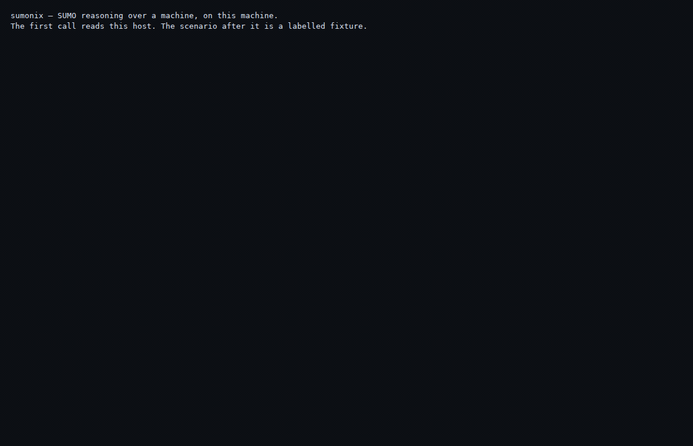

<!-- generated by tools/build-readme.sh; do not edit -->

# sumonix (SUMO + NixOS) Semantic OS 🦙

> **Built for audit-grade reasoning. Ships a policy gate with a proof. Extends by design, not by accident.**

<p align="center">
  
</p>

**The system holds a semantic model of itself — declared and observed — reasons over it
with proofs, catches contradictions before anything builds, explains drift while running,
and proposes declarative repairs it can verify before a human applies them.**

**The vision:** NixOS configurations, nixpkgs derivations, CI pipelines, and runtime telemetry all contribute facts to a single SUMO-native knowledge base. A forward-chaining engine derives transitive closures (dependencies, vulnerabilities, capabilities), subsumes through equivalences, and answers queries with full provenance. Policies are Horn rules; violations halt the build with an independently re-checkable proof. A relaxation menu shows exactly which overrides flip the verdict. Extensions for disjunction, aggregates, soft rules, temporal logic, and congruence closure are admitted by design — each a pure Nix module behind a flag, never touching the eval path unless explicitly enabled.

> **What runs today (V3 + Phase 3):** parser, ontology with equivalence union-find, declaration-driven synthesis (166 rules from SUMO's own `TransitiveRelation`/`subrelation`/`inverse`…), stratifier (349 neg-cycle rejections with reasons), ingestion (116 Horn rules from Merge.kif, default-on), naive engine (~1.1 s), proof export + zero-shared-code checker, build gate with proof-of-violation, relaxation menu (single flips + size-2 flips + minimal supports), **universal JSON/YAML/TOML ⇄ KIF schema mapper**, **policy pack loader**, **transition bundle verification**, **5-stage audit pipeline** (vulns + licenses).

> **What's next (pick one):** congruence closure (equal things interchangeable), aggregates/builtins (version ranges, counts), disjunctive heads (choice), soft rules/MaxSAT (minimize violations), well-founded negation, bounded existentials, temporal logic — each an independent module with its own test and demo, never touching the eval path unless explicitly enabled.
## 🎯 What This Is — Core Layers

| Layer | Component | What It Does |
|-------|-----------|--------------|
| 📖 **Parser** | `kif.nix` | SUO-KIF text → S-expressions (atoms = strings, lists = lists) |
| 🧠 **Ontology** | `sumo.nix` | `subclass`/`instance`/`equivalent` → ancestors, classOf, `isSubclass`, `isInstance`, domains, well-typedness |
| ⚙️ **Engine** | `datalog.nix` | Naive forward chaining over Horn rules; every derived fact carries `{ rule, from, round, bindings }` |
| 🔬 **Synthesis** | `reasoner/synthesize.nix` | Reads SUMO's own declarations (`TransitiveRelation`, `SymmetricRelation`, `subrelation`, `inverse`, `subAttribute`…) and *writes* Horn rules — no hand-curation |
| 🛡️ **Stratifier** | `reasoner/stratify.nix` | Predicate dependency graph; rejects every rule on a negative cycle with a reason; assigns strata |
| 📥 **Ingestion** | `reasoner/ingest.nix` | Classifies all `=>`/`<=>`/`forall` forms from Merge.kif; strips quantifiers, splits `or`/`and`, drops ancestor-prop duplicates, applies stratifier cut |
| 📜 **Proof Export** | `reasoner/proof.nix` | Emits a KIF certificate: ontologies, rules (engine IDs), axioms, steps in round order, bindings, goal |
| ✅ **Independent Checker** | `proof-check.nix` | Zero shared code. Re-parses, re-derives subsumption, re-evaluates each step. Tamper → loud failure. |
| 🚧 **Policy Gate** | `policy/build-gate.nix` | `check { goal; passWhen }` → pass/fail with proof tree. `mkPolicyChecked` → derivation that fails the *build* with the proof when policy is violated. |
| 🧭 **Relaxation Menu** | `policy/relax.nix` | When a gate fails: lists every single toggle whose removal flips the verdict (with proof sketch), size-2 flips when no single does, and minimal supports for a passing goal. |
| 🔄 **Schema Mapper** | `reasoner/schema.nix` | Universal JSON/YAML/TOML ⇄ KIF adapter — parse, emit, validate, generate predicate signatures |
| 📦 **Policy Packs** | `reasoner/policy-pack.nix` | Composable policy packs as flake inputs (schema + rules + ontology + metadata) |
| 📋 **Transition Bundles** | `reasoner/transition-bundle.nix` | Verified change operations: preconditions, edits, simulation, compensation, idempotency check |
| 🔍 **Audit Pipeline** | `reasoner/audit.nix` | 5-stage ingestion: runtime closure, config closure (flake.lock), vulnerabilities (OSV), licenses (SPDX), policy check |

> **Interfaces are narrow and total; layers replace independently.**
## 🏆 V3 — The Policy Product (Shipping Now)

| Milestone | What You Get |
|-----------|--------------|
| **V1** ✅ | Horn ingestion runs; full test suite green |
| **V2** ✅ | Every derived fact has an exported, independently re-checked proof |
| **V3** ✅ | **Build-time enforcement with a proof-of-violation + a relaxation menu** — the demo that justifies this project |
| **Phase 3** ✅ | **Schema Mapper + Policy Packs + Transition Bundles + Audit Pipeline** — universal adapters, composable packs, verified changes, 5-stage audit |
| **V4** ⏳ | Differential CI (Soufflé) — deferred |

> **Benchmark:** ~1.1 s on 286 rules / 23–185 derived facts (ingestion scenario). Well under the 5 s gate. The naive engine ships; semi-naive is skipped.
## 🏗️ Architecture

```
┌─────────────────────────────────────────────────────────────────────────────┐
│                         SUMONIX DATA FLOW                                    │
├─────────────────────────────────────────────────────────────────────────────┤
│                                                                              │
│  Merge.kif ──┐                                                              │
│  nix-domain  ├─► ingest.classify ──► { ontology │ horn-rules │ rejected }   │
│  SEEDS       ┘       │                    │                                 │
│                      ▼                    ▼                                 │
│                sumo.nix (+equiv)    engine.run (naive; proven fast enough)  │
│                                          │                                   │
│                   ┌────────────────────┼────────────────────┐               │
│                   ▼                    ▼                    ▼               │
│             policy gate          relaxation menu        proof export       │
│             (build fails on      (flip-candidates,      (proof.kif →       │
│              violation)           min-drop set)          proof-check.nix)   │
│                                                                              │
├─────────────────────────────────────────────────────────────────────────────┤
│                        PHASE 3 EXTENSIONS                                    │
├─────────────────────────────────────────────────────────────────────────────┤
│                                                                              │
│  JSON/YAML/TOML ──► schema.nix ──► KIF facts ──► engine ──► violations     │
│       │                                    │                                 │
│       ▼                                    ▼                                 │
│  policy-pack.nix ◄── schema.kif      audit.nix (5 stages)                   │
│       │                                    │                                 │
│       ▼                                    ▼                                 │
│  transition-bundle.nix ──► verified changes (preconditions, edits,         │
│                          simulation, compensation, idempotency)             │
│                                                                              │
└─────────────────────────────────────────────────────────────────────────────┘
```

**Interfaces are narrow and total; layers replace independently.**
## 📜 Extension Contract — Everything Admitted by Design

**Rule zero:** needs unbounded FOL or unbounded satisfiability on this ontology ⇒ **offline tooling** or **validation-only CI**, never `nix eval`.

### 🟢 Implemented in Engine (T2.x / P3)

| Capability | Extension Point | Milestone | Termination | Proof Tag |
|------------|-----------------|-----------|-------------|-----------|
| Disjunctive consequent | IR `disjunct [B C]` | T2.1 | branch enumeration + per-branch fixpoint | `by disjunct#<i>` |
| Well-founded negation | three-valued eval + alternating fixpoint | T2.2 | bounded by strata size | `by unknown#neg` |
| Existential consequent / Skolem | bounded grounding (finite domain) | T2.3 | finite domain ⇒ terminates | `by exists-witness` |
| Antecedent disjunction | compile-time `or` → two Horn rules | P3 (free) | unchanged | `by or-split` |
| `iff` / `<=>` | compile-time split into two `=>` | P3 | unchanged | both directions |
| Equality & congruence | generated schemas over fact terms | T2.4 | finite terms ⇒ finite closure | congruence paths |
| Knuth–Bendix completion | offline `completion.nix` | T2.5 | offline; depth-limited | n/a |
| Aggregates & arithmetic | builtins registry (`greaterThan`, `subsetOf`, …) | P3 / T2.6 | pure Nix comparisons | `by builtin#<name>` |
| Non-ground `ask` + aggregates | IR `aggregate` with group-by | T2.6 | finite solutions | `by aggregate#count` |

### 🟡 Planned Extensions (T3.x)

| Capability | Extension Point | Milestone | Termination | Proof Tag |
|------------|-----------------|-----------|-------------|-----------|
| Weighted/soft rules & MaxSAT | rule weights + violation minimization | T3.1 | bounded candidate set | `by soft#<w>` |
| Abductive repair | minimal failing sets (hitting-set) | P5 (menu) | bounded candidates | `by abduced` |
| External compiled backend | differential CI (Soufflé) | T2.7 | n/a | proofs must match |
| Parallel eval | semi-naive rounds are set-parallel | T3.2 | unchanged | unchanged |
| Temporal/Modal | binary predicates + dedicated module | T3.3 | finite time atoms | modal tags |

### 🔴 Excluded from Eval Path

| Capability | Reason |
|------------|--------|
| Full FOL / disjunctive stable models | unbounded satisfiability; requires offline tooling |

> **Every row is an accepted obligation with a test or a documented reject path. Nothing is admitted by accident.**
## 🌍 Application Bootstraps — The Complete Vision

The core engine is the **kernel**. Each bootstrap below is an independent pure-Nix module (converter + policy pack + demo) that plugs into it. No CI, no external deps — just `sumo-nix` as the universal proof layer.

### 🟢 Ready Now (Core NixOS/nixpkgs)

| # | Bootstrap | What It Lifts | Demo Query | Effort |
|---|-----------|---------------|------------|--------|
| 🟢 **B1** | **Nixpkgs Ontology** | 100k+ packages, deps, licenses, meta | "Find all BSD-licensed web servers with no network deps" | 2–4 h |
| 🟢 **B2** | **Epistemic Flakes** | Compliance rules as flake inputs | "Build fails: PII package depends on network-transmitter" | 1–2 h |
| 🟢 **B3** | **json2kif / yaml2kif** | Any JSON/YAML → KIF facts | "Which services use secrets AND expose public ports?" | 1–2 h |

### ☁️ Infrastructure & Cloud

| # | Bootstrap | What It Lifts | Demo Query | Effort |
|---|-----------|---------------|------------|--------|
| ☁️ **B4** | **Terraform Plan** | `terraform show -json` | "Prove this plan has no public sensitive data" | 2–3 h |
| ☁️ **B5** | **K8s / Docker Compose** | Manifests → KIF | "Which containers are privileged AND exposed?" | 2–3 h |
| 🔥 **B11** | **Firewall / SG Analyzer** | iptables, AWS SG, K8s NetworkPolicy | "Is SSH exposed? Which rules are shadowed?" | 2–3 h |

### 🔗 Supply Chain & Security

| # | Bootstrap | What It Lifts | Demo Query | Effort |
|---|-----------|---------------|------------|--------|
| 🔗 **B6** | **Lockfile + OSV/NVD** | package-lock.json + OSV API | "Is my-app exposed to CVE-2024-1234 via transitive deps?" | 2–4 h |
| ⚖️ **B7** | **License Oracle** | SPDX + dep graph | "Can this proprietary artifact ship?" | 2–3 h |
| 📄 **B19** | **Compliance Receipt** | Check results → signed receipt | "Audit artifact for GDPR" | 1–2 h |
| 🏷️ **B20** | **Proof Badges** | Check results → SVG badges | `` links to proof | <1 h |

### 📡 APIs & Contracts

| # | Bootstrap | What It Lifts | Demo Query | Effort |
|---|-----------|---------------|------------|--------|
| 📡 **B8** | **OpenAPI / JSON Schema** | OpenAPI v1/v2 → KIF | "Is v2 backward compatible with v1 clients?" | 2–4 h |
| 📡 **B23** | **API Evolution** | OpenAPI + client contracts → KIF | "Is v2 backward compatible?" | 2–3 h |

### 🗄️ Data & Lineage

| # | Bootstrap | What It Lifts | Demo Query | Effort |
|---|-----------|---------------|------------|--------|
| 🗄️ **B9** | **SQL / dbt Lineage** | DDL / dbt manifest → KIF | "Which BI models contain email addresses?" | 3–4 h |

### 📝 Code & Git

| # | Bootstrap | What It Lifts | Demo Query | Effort |
|---|-----------|---------------|------------|--------|
| 📝 **B10** | **Git + CODEOWNERS** | Git log + CODEOWNERS → KIF | "Who must review changes to payment code?" | 1–2 h |
| 🔍 **B16** | **Semantic Grep** | Repo files → KIF concepts | `sumo grep . "PII fields"` | 1–2 h |
| 🧹 **B15** | **Git Hygiene** | Git ls-files + patterns → KIF | "Are secret-like files tracked?" | <1 h |

### ⚙️ CI/CD & Config

| # | Bootstrap | What It Lifts | Demo Query | Effort |
|---|-----------|---------------|------------|--------|
| ⚙️ **B13** | **CI Pipeline Optimizer** | GitHub Actions / GitLab CI → KIF | "Does deploy run before tests? Any fork secrets?" | 1–2 h |
| 🔧 **B14** | **Env Validator** | .env + app meta → KIF | "Is production fully configured?" | <1 h |
| ⚙️ **B24** | **Config Contradiction** | NixOS modules → KIF | "Postgres needs 5432 but StrictFirewall denies all" | 2–3 h |

### 🔐 Identity & Access

| # | Bootstrap | What It Lifts | Demo Query | Effort |
|---|-----------|---------------|------------|--------|
| 🔐 **B12** | **RBAC / ABAC Explainer** | IAM, groups, roles, resources | "Can alice read prod-db? Why/why not?" | 1–2 h |
| 🔐 **B22** | **Crypto Epistemology** | HW state, network, user → KIF | "Secret only exists on corp Wi-Fi + disk unlocked" | 2–3 h |

### 📦 Packages & Tasks

| # | Bootstrap | What It Lifts | Demo Query | Effort |
|---|-----------|---------------|------------|--------|
| 🎯 **B21** | **Semantic Package Select** | Nixpkgs ontology + constraints | `selectPackage { provides="WebServer"; NoGPL }` | 2–3 h |
| 📋 **B17** | **Ontology Task Runner** | Task declarations → KIF | "What tasks to build running-service?" | 1–2 h |
| 💥 **B18** | **Change Impact** | Dependency graph + facts → KIF | "What breaks if I remove redis?" | 2–3 h |

### 🛡️ Policy & Flakes

| # | Bootstrap | What It Lifts | Demo Query | Effort |
|---|-----------|---------------|------------|--------|
| 📦 **B25** | **Policy-as-Flakes** | Flake inputs → KIF rules | `inputs.gdpr.url = "github:org/gdpr-kif"` | 1–2 h |
| ✅ **B26** | **sumo flake check** | Checks → Nix flake checks | `nix flake check` fails with proof | <1 h |
| 🛡️ **B27** | **sumo assert** | `sumo.assert { query; }` in Nix | Build fails with proof in Nix eval | <1 h |

### 🤔 Documentation

| # | Bootstrap | What It Lifts | Demo Query | Effort |
|---|-----------|---------------|------------|--------|
| 🤔 **B28** | **Why-does-this-exist** | Resource facts → generated docs | "Why does redis-cache exist?" | 1–2 h |

---

### How They Compose

| Milestone | What It Means |
|-----------|---------------|
| **V2** | Core engine + **1 bootstrap** (e.g., B3 json2kif + B14 env validator) |
| **V3** ✅ | V2 + policy product (build gate + relaxation menu) + **3 bootstraps** composing |
| **V4** | V3 + **3 bootstraps** composing + T2.4/T2.6 engine extensions |
| **V5** | All **28 bootstraps** + T2.1/T2.6/T3.1 + T2.7 (Soufflé CI) |

> Each bootstrap = converter + policy pack (KIF rules) + demo query. Pure Nix, no CI, no external deps.
## 🧪 What's Covered (and What's Not)

| ✅ Covered | ❌ Not Yet |
|------------|------------|
| `subclass` / `instance` / `domain` / `equivalent` → full taxonomy | `Mid-level-ontology.kif` (separate file) |
| `TransitiveRelation`, `SymmetricRelation`, `ReflexiveRelation` → synthesized Horn rules | `documentation`, `termFormat`, `format` (human-readable only) |
| `subrelation`, `inverse`, `subAttribute` → synthesized Horn rules | `exhaustiveAttribute`, `contraryAttribute`, `disjoint` (need disjunction → E1) |
| Horn rules from Merge.kif (`=>` with grounded consequent) | quantified / negated / function consequents (rejected with reasons) |
| `and`, `exists`, `not` (NAF), `equal`, `instance` (with subsumption) | `or` in antecedent (E4), `forall` in consequent (E1) |
| Proof export + independent re-check | Knuth–Bendix completion (offline tool) |
| Build-time gate with proof-of-violation | Aggregates / arithmetic (E8, registry ready) |
| Relaxation menu (single + size-2 flips + supports) | Soft rules / MaxSAT (E9) |
| **Schema Mapper: JSON/YAML/TOML ⇄ KIF** | — |
| **Policy Packs: composable flake inputs** | — |
| **Transition Bundles: verified change operations** | — |
| **Audit Pipeline: 5-stage (vulns + licenses)** | — |

**Honesty of rejection:** every unsupported form is rejected **with a reason**; nothing is silently dropped; no `throw` on user data paths.
## 🚀 Quick Start

```bash
# All tests in one go (uses the local store; safe to re-run)
./run-tests.sh

# Or individually (this wrapper sets the local store dirs and --impure for you)
./nix-eval.sh --expr 'import ./tests/default.nix'       # "ok"
./nix-eval.sh --expr 'import ./tests/rules.nix'          # "ok"
./nix-eval.sh --expr 'import ./tests/ingest-smoke.nix'   # "ok"
./nix-eval.sh --expr 'import ./tests/proof-check.nix'    # "ok"
./nix-eval.sh --expr 'import ./tests/unit/relax.nix'     # "ok"
```

**Replay the 60-second demo:**
```bash
./demo/run
```

**Generate the CVE proof artifact (deterministic, byte-identical):**
```bash
./nix-eval.sh --raw --expr 'import ./tests/proof-artifact.nix' > proof.kif
```

**Re-check it independently (zero shared code with the engine):**
```bash
./nix-eval.sh --expr '(import ./proof-check.nix { file = ./proof.kif; })'
# → "proof: 9 steps, independently re-checked ✓"
```

**Unit tests:** `./run-tests.sh` runs every test in `tests/`, including the unit suites (`equivalents`, `synthesize`, `stratify`, `relax`, `congruence`, `builtins`, `disjunctive`, `soft-rules`, `wfs`, `existentials`, `temporal`, `lift-config`, `drift`, `repair`, `metavisor`, `diag`, `runtime-policy`) and the metavisor tick smoke test.

---

### 🛰 Resident Metavisor (M3A) — Live Drift Detection

```bash
# On any NixOS host: enable the systemd timer
# imports = [ inputs.sumonix.nixosModules.sumonix-metavisor ];
# services.sumonix-metavisor.enable = true;

# The same operations without the module:
sumo lift --configuration /etc/nixos/configuration.nix > declared.kif
tools/observe.sh > observed.kif
sumo drift --declared declared.kif --observed observed.kif

# Repairs: one option edit per candidate, re-lifted and re-gated.
sumo repair --configuration /etc/nixos/configuration.nix

# The gate alone: exits 1 with the why-tree when the config contradicts system.kif.
sumo gate --configuration /etc/nixos/configuration.nix

# The event log (append-only, one JSON line per new drift/violation):
cat /var/lib/sumonix-metavisor/events.jsonl
journalctl -t sumonix-metavisor
```

---

### 🔬 Phase 3 Commands (New)

```bash
# Schema Mapper: parse JSON to KIF
sumo pack add github:myorg/policy-pack

# Audit: vulnerabilities + licenses from flake.lock
sumo audit --json

# Plan: create a verified transition bundle
sumo plan --goal '(policyViolation "nginx" "NoFirewallAllowance")' --json

# Apply: verify and apply a bundle (L2: human-approved)
sumo apply --bundleId <id>
```
## 📦 Repository Layout (Stable)

```
├── kif.nix                    # SUO-KIF parser
├── sumo.nix                   # Ontology: ancestors, classOf, isSubclass, isInstance, equivalent union-find
├── datalog.nix                # Naive engine + trace (round, bindings, proof)
├── pins.nix                   # Pinned SUMO corpus (SHA-256 verified)
├── nix-domain.kif             # NIX classes/relations under SUMO
├── rules.kif                  # Hand-written rules for the CVE demo
├── system.kif                 # System policy rules (R1-R5: firewall, drift, user, secrets, licenses)
├── reasoner/
│   ├── synthesize.nix         # Declaration → Horn rules (TransitiveRelation, subrelation, inverse, …)
│   ├── ingest.nix             # Merge.kif classification + transforms + stratifier cut
│   ├── stratify.nix           # Predicate graph + strata + neg-cycle rejection
│   ├── lift-config.nix        # Pure nixosConfig → KIF with option-path provenance
│   ├── config-gate.nix         # Well-typedness + policy gate (throws with the why-tree)
│   ├── drift.nix               # Attested drift + rogue listeners (Horn + NAF)
│   ├── metavisor.nix           # Source labels + proof IDs over drift (M3A)
│   ├── repair.nix              # One option edit per candidate, verified by re-lifting
│   ├── proof.nix              # KIF certificate generator
│   ├── proof-artifact.nix     # Deterministic proof.kif for the CVE scenario
│   ├── schema.nix             # Universal JSON/YAML/TOML ⇄ KIF adapter
│   ├── policy-pack.nix        # Composable policy packs as flake inputs
│   ├── transition-bundle.nix  # Verified change operations (preconditions, edits, simulation)
│   ├── audit.nix              # 5-stage audit pipeline (vulns + licenses)
│   ├── builtins.nix           # Builtin registry (versionInRange, licensePolicy, etc.)
│   ├── wfs.nix                # Well-founded semantics (three-valued logic)
│   ├── congruence.nix         # Congruence closure (equivalence classes)
│   ├── temporal.nix           # Temporal reasoning (before, after, within, holdsAt)
│   ├── soft-rules.nix         # Weighted rules + MaxSAT relaxation
│   ├── existential.nix        # Bounded existential reasoning
│   └── well-typed.nix         # Well-typedness gate for lifted facts
├── proof-check.nix            # Independent checker (zero shared code)
├── policy/
│   ├── build-gate.nix         # check / mkPolicyChecked (both polarities)
│   └── relax.nix              # Relaxation menu (flips + supports)
├── tests/
│   ├── default.nix            # Oracle: 5,505 forms, 712/714 classes, Human ancestors, etc.
│   ├── rules.nix              # CVE scenario on hand-written rules
│   ├── ingest-smoke.nix       # CVE scenario WITH ingestion ON
│   ├── proof-check.nix        # Committed proof.kif + 4 tamper tests
│   ├── unit/
│   │   ├── equivalents.nix    # Equivalence subsumption
│   │   ├── synthesize.nix     # Declaration-driven synthesis
│   │   ├── stratify.nix       # Stratifier behavior
│   │   ├── relax.nix          # Relaxation menu behavior
│   │   ├── lift-config.nix    # Lift + gate on real NixOS configs
│   │   ├── drift.nix          # Drift / rogue / stale observation
│   │   ├── repair.nix         # Verified single-option repair
│   │   ├── metavisor.nix      # Source-labeled surface + NixOS module wiring
│   │   ├── diag.nix           # KIF diagnostics (typos, unknown preds)
│   │   ├── builtins.nix       # Builtin registry tests
│   │   ├── disjunctive.nix    # Disjunctive consequent tests
│   │   ├── soft-rules.nix     # Soft rules / MaxSAT tests
│   │   ├── wfs.nix            # Well-founded semantics tests
│   │   ├── existentials.nix   # Bounded existential tests
│   │   ├── temporal.nix       # Temporal reasoning tests
│   │   ├── congruence.nix     # Congruence closure tests
│   │   └── runtime-policy.nix # R3/R4/R5 runtime policy tests
├── container/nixos/
│   ├── sumo.nix               # services.sumonix (CLI, facts, guard)
│   └── metavisor.nix          # services.sumonix-metavisor (timer + event log)
├── container/run.sh           # D1 harness: build|run NixOS-in-Podman VM
├── proof.kif                  # Committed artifact (9 steps, independently re-checked)
├── demo/                      # The 60-second demo: scenes, transcripts, asciinema casts
│   ├── run                    # ./demo/run [scene ...] — replay the whole demo
│   ├── record                 # Re-record all scenes (asciinema)
│   ├── gen-facts.sh           # Refresh demo/facts/nixpkgs.kif from pinned nixpkgs
│   ├── scenes/                # 01-30-seconds, 02-capabilities, 03-pages, 04-crosswalk, 05-when-the-build-breaks
│   ├── nix/                   # Nix-side digests the scenes print (org digest, crosswalk, policy)
│   └── facts/nixpkgs.kif      # Pinned real-nixpkgs facts (committed, offline)
├── tools/
│   ├── env.sh                 # Shared environment (local store dirs)
│   ├── build-readme.sh        # Generates README.md from docs/readme/*.md
│   ├── tour.sh                # Records asciinema tour
│   ├── shot.sh                # TUI dump → PNG
│   ├── movie.sh               # Cast → animated GIF
│   ├── metavisor-tour.sh      # Drives D1 container demo
│   ├── observe.sh             # Live observer (systemd, /proc, ss)
│   └── host-facts.sh          # Demo host facts (live + fixture)
├── nix-eval.sh                # Convenience wrapper (local store dirs, --impure)
├── run-tests.sh               # Whole suite in one go
├── spike/                     # Capability discovery VM (optional)
├── org/ hf/ bags.nix tq.nix   # Other demos (Hugging Face tags, org pages, test bags)
├── flake.lock                 # Pinned nixpkgs (used by audit pipeline)
├── .osv-cache.json            # OSV vulnerability cache (for audit)
└── .spdx-cache.json           # SPDX license cache (for audit)
```
## 🎬 The 60-Second Demo

`./demo/run` plays the same five scenes every time — no setup, no network, ~30 seconds. Each is a standalone recording in `demo/casts/` (`asciinema play demo/casts/<scene>.cast`). Nothing here is a mock: every line is the real engine answering a real question, and the output below is pasted verbatim from `./demo/run`.

```bash
./demo/run    # all five, in order
./demo/run 02-capabilities.sh   # just one
```

---

### 🎭 Scene 1: The 30-Second Proof

The build fails; the engine knows why; the why is a file you can re-check, and the checker shares no code with the engine:

```console
│ Step 2 — re-check the certificate with a checker that shares no code with the engine.
$ ./nix-eval.sh --expr '(import ./proof-check.nix { file = /tmp/proof.kif; })'
"proof: 9 steps, independently re-checked ✓"
│ Step 3 — alter the certified goal; the checker must refuse it.
│ refused ✓  (the checker exits non-zero and says which line broke)
```

---

### 🎭 Scene 2: Your Package Set, Reasoned Over

Real nixpkgs facts (60 packages, committed, pinned, offline) answer questions a README cannot: which capabilities compose, which your transitive closure unlocks, and where 3+ capabilities combine:

```console
📦 DIRECT COMPOSITIONS (6) — package + immediate deps:
  🔗 nginx composes HTTPServer + TLS
🌐 ENABLED CAPABILITIES (10) — via transitive dependency closure:
  ✨ nginx enables X509 via dependency closure
💡 SYNERGIES (2):
  🚀 nginx synergy: Crypto + TLS + X509
```

---

### 🎭 Scene 3: Your Organization, Reasoned Over

The Pick Your AI repositories, pinned and taxonomized under SUMO: 2,109 pages, 666 of them process documents by *class reasoning*, zero unclassified, identical copies and retired team names found by hash, every finding carrying its proof:

```console
Total pages taxonomized:            2109
Identical copies found:             SupportGuide: 3 of 10 identical
Former team names still in use: 7
(staleName …)    by staleName#1
  (usesFormerName …)    asserted
```

---

### 🎭 Scene 4: The Crosswalk Knows What It Knows

Typed questions over PyAI fields ↔ HF tags ↔ SUMO classes. Answers are 0/1 *plus an explicit null* — when there is no rule, you get "I don't know", never a silent no:

```console
A PyAI field: “Dataset Modality = Text” — which axis is it, and what does it mean?
    q1: modality
    q2: Text
task:any-to-any  (“input and output vary”) — …"I don't know", on purpose:
    q8: unknown (null probability 1.000000)
```

---

### 🎭 Scene 5: The Build Fails — And Here Is Why

The gate, the proof it emits, and the relaxation menu answering the question "what do I actually have to change?":

```console
GATE — the build fails:
(policyViolation nginx NoCriticalRunningCVE)    by policyViolation#4
  (vulnerable nginx CVE-2026-9999)    by vulnerable#3
…
Menu — which single override flips the verdict?
  ✓ ignore the advisory
  ✓ drain nginx
  ✓ reclassify as low
  ✓ remove the policy rule
```

---

### 🎨 Bonus: The Panel (TUI Dashboard)

The same digest, rendered as a live TUI (`sumo dashboard`): services, capability atlas, the policy verdict with its proof, and a chart:


---

### 🎬 The Movie

`./tools/tour.sh` records the whole walkthrough to `docs/demo/tour.cast`:

```console
$ ./tools/tour.sh
$ asciinema play docs/demo/tour.cast
```

It opens on **this machine**, not on a script: `demo/host-facts.sh` reads running systemd units, the kernel release, listening sockets, and the Nix store if the host has one, and writes facts headed `source: live`. `sumo status` then shows the count it actually observed.

The session continues with a **labelled fixture** — an nginx service and a synthetic critical advisory — so the policy verdict and its proof are reproducible: `sumo caps`, `sumo closure nginx`, `sumo query '(vulnerable nginx CVE-2026-9999)'`, `sumo whatif`, `sumo guard` (exit 1: the gate refuses the build), an independent `proof-check` of the emitted certificate, and finally the TUI dump from the same digest.

Both artifacts are generated, not pasted: `./tools/tour.sh` (asciinema), `./tools/movie.sh` (cast → animated GIF, since GitHub renders GIFs but strips player embeds), and `./tools/shot.sh` (TUI dump → PNG).

Record your own: `./demo/record` re-records every scene (needs `asciinema`). Full script and cast index: `demo/README.md`.

---

### 📊 Live Facts vs Fixtures

`sumo status` prints where its facts came from:

```
Facts:  live 21 (systemd, /proc, ss, nix-store when present)
        fixture 18 (scenario facts, capability atlas)
```

| Source | Label | What It Is |
|--------|-------|------------|
| `demo/host-facts.sh` | `live` | observed on the host at run time |
| `demo/facts/host.kif` | `fixture` | the deterministic nginx/CVE scenario |
| `demo/facts/nixpkgs.kif` | `fixture` | 60 pinned nixpkgs packages for the capability atlas |

A fixture fact is never printed as an observation. On a host without a Nix store or without a CVE, the live pass reports zero packages and `PASS` — that is the truth, not a gap to paper over. `--json` carries the same split as `"sources":{"live":N,"fixture":M}`.

---

### ⚠️ One Current Limitation

The engine runs under `nix eval`, so every subcommand costs roughly a second of evaluation. The demo stays inside the two-run budget; `sumo dashboard` refreshes on a timer rather than on keystroke.
## 🛰 Metavisor Live Loop (D1) — The Container Demo

`./tools/metavisor-tour.sh` drives three metavisor scenes against a real NixOS-in-Podman systemd host — no fixtures, no mocks.

### Prerequisites

```bash
# Enable unprivileged user namespaces (required for build in diverted store)
sudo sysctl -w kernel.unprivileged_userns_clone=1

# Build the VM
./container/run.sh build
```

### Scene 1: The Gate

A NixOS module with a wildcard postgres listener and a closed firewall fails `sumo gate` with a proof naming both option paths:

```console

1 · The gate: postgres listens on 0.0.0.0, the firewall allows nothing
    -> the eval fails with a proof naming both option paths

$ ./bin/sumo gate --configuration container/nixos/d1-bad.nix
gate: violation — the configuration contradicts system.kif
(policyViolation "services.postgresql" NoFirewallAllowance)    by policyViolation#6
  (declaredService "services.postgresql" "services.postgresql.enable")    asserted
  (firewallEnabled "networking.firewall.enable")    asserted
  (serviceListener "services.postgresql" "0.0.0.0")    by serviceListener#3
    (listenerDeclared "services.postgresql" "0.0.0.0" "services.postgresql.settings.listen_addresses")    asserted
  (servicePort "services.postgresql" "5432")    by servicePort#2
    (portInferred "services.postgresql" "5432" "services.postgresql.settings.port")    asserted
  (firewallTcpOption "networking.firewall.allowedTCPPorts")    asserted

2 · Stop the declared unit; one timer tick later the drift is proven

$ systemctl stop postgresql
$ run the metavisor tick
🛰 METAVISOR (source-labeled)
  declared: /etc/sumo/declared.kif (<n> facts)
  observed: /run/sumo/observed.kif (<n> facts, snapshot snap-<id>, exporter <exporter>)
  status: drift
  drift:
    - unit postgresql.service  (sha256:<hash>)
      (drift "postgresql.service")    by drift#7
        (declaredRunning "services.postgresql" "services.postgresql.enable")    asserted
        (aliasOf "services.postgresql" "postgresql.service")    asserted
        (completeFor unitActive "snap-<id>")    asserted
        (freshSnapshot "snap-<id>")    asserted
journal: drift unit=postgresql.service (proof sha256:<hash>)

    and a listener nobody declared is a violation, not a guess

$ nc -l 0.0.0.0 9999   # a rogue listener
🛰 METAVISOR (source-labeled)
  declared: /etc/sumo/declared.kif (<n> facts)
  observed: /run/sumo/observed.kif (<n> facts, snapshot snap-<id>, exporter <exporter>)
  status: violation
  drift:
    - unit postgresql.service  (sha256:<hash>)
      (drift "postgresql.service")    by drift#7
        (declaredRunning "services.postgresql" "services.postgresql.enable")    asserted
        (aliasOf "services.postgresql" "postgresql.service")    asserted
        (completeFor unitActive "snap-<id>")    asserted
        (freshSnapshot "snap-<id>")    asserted
  rogue listener:
    - nc on 0.0.0.0:9999  (sha256:<hash>)
      (rogueListener "nc" "0.0.0.0" "9999")    by rogueListener#8
        (completeFor listener "snap-<id>")    asserted
        (freshSnapshot "snap-<id>")    asserted
        (observedListener "nc" "0.0.0.0" "9999" "snap-<id>")    asserted
journal: rogueListener process=nc addr=0.0.0.0 port=9999 (proof sha256:<hash>)

3 · Repair: ranked single-option patches, each re-lifted and re-gated

$ podman exec sumonix-demo /run/current-system/sw/bin/bash -lc /run/current-system/sw/bin/sumo repair --configuration /etc/nixos/bad.nix
base gate: violation
(policyViolation "services.postgresql" NoFirewallAllowance)    by policyViolation#6
  (declaredService "services.postgresql" "services.postgresql.enable")    asserted
  (firewallEnabled "networking.firewall.enable")    asserted
  (serviceListener "services.postgresql" "0.0.0.0")    by serviceListener#3
    (listenerDeclared "services.postgresql" "0.0.0.0" "services.postgresql.settings.listen_addresses")    asserted
  (servicePort "services.postgresql" "5432")    by servicePort#2
    (portInferred "services.postgresql" "5432" "services.postgresql.settings.port")    asserted
  (firewallTcpOption "networking.firewall.allowedTCPPorts")    asserted
candidates: 3, verified: 3, rejected: 0

#1 allow port 5432 in the firewall
--- a/configuration.nix
+++ b/configuration.nix
@@ networking.firewall.allowedTCPPorts @@
-  networking.firewall.allowedTCPPorts = [];
+  networking.firewall.allowedTCPPorts = [5432];
re-lifted gate: pass
no derivable policyViolation; all lifted facts well typed

#2 bind services.postgresql to localhost
--- a/configuration.nix
+++ b/configuration.nix
@@ services.postgresql.settings.listen_addresses @@
-  services.postgresql.settings.listen_addresses = "0.0.0.0";
+  services.postgresql.settings.listen_addresses = "localhost";
re-lifted gate: pass
no derivable policyViolation; all lifted facts well typed

#3 disable services.postgresql
--- a/configuration.nix
+++ b/configuration.nix
@@ services.postgresql.enable @@
-  services.postgresql.enable = true;
+  services.postgresql.enable = false;
re-lifted gate: pass
no derivable policyViolation; all lifted facts well typed
$ apply #1: networking.firewall.allowedTCPPorts = [5432]

$ nixos-rebuild build   # the gate runs inside the rebuild
nixos-rebuild build: gate passed, the patched system built

$ podman exec sumonix-demo /run/current-system/sw/bin/bash -lc /run/current-system/sw/bin/sumo repair --configuration /tmp/patched.nix
base gate: pass
no violation to repair
candidates: 0, verified: 0, rejected: 0

no verified repair

4 · Rootless limit, stated not hidden: postgres runs as its own uid, so
    `ss` cannot attribute its socket -> status unknown, never a false pass (R1)

🛰 METAVISOR (source-labeled)
  declared: /etc/sumo/declared.kif (<n> facts)
  observed: /run/sumo/observed.kif (<n> facts, snapshot snap-<id>, exporter <exporter>)
  status: unknown - observation partial: need fresh completeFor unitActive and listener attestations
journal: unknown: observation partial: need fresh completeFor unitActive and listener attestations
```

*(The transcript above is the full normalized output from the container run.)*

### Scene 2: Live Drift

The declared unit is stopped; one timer tick later `sumo status` and the journal carry the drift with its proof. A listener nobody declared is a violation, not a guess.

### Scene 3: Verified Repair

`sumo repair` ranks single-option patches, each re-lifted and re-gated; the top patch is applied and the whole system rebuilds through the same gate.

---

### How It Works

| Step | Command | What Happens |
|------|---------|--------------|
| 1 | `./container/run.sh build` | Builds NixOS VM with bad config (postgres on 0.0.0.0, no firewall) |
| 2 | `./container/run.sh run` | Boots VM, installs sumo CLI |
| 3 | `sumo gate` | Fails build with proof naming `services.postgresql.settings.listen_addresses` and `networking.firewall.allowedTCPPorts` |
| 4 | `systemctl stop postgresql` | Stops declared unit |
| 5 | metavisor tick | Detects drift, emits proof, writes journal |
| 6 | `nc -l 0.0.0.0 9999` | Starts rogue listener |
| 7 | metavisor tick | Detects rogue listener, emits violation |
| 8 | `sumo repair` | Ranks 3 patches (open port, bind localhost, disable service) |
| 9 | Apply #1 + rebuild | System rebuilds through gate → passes |

The transcript is normalized (timestamps, snapshot ids, hashes) and byte-compared in CI, so a changed claim fails the build.

Record the cast: `./tools/metavisor-tour.sh --record` → `docs/demo/metavisor-tour.cast`. The container harness is `./container/run.sh build|run`, and its NixOS configuration is `container/container.nix`.
## 📖 Further Reading

| Doc | What's Inside |
|-----|---------------|
| `demo/README.md` | The 60-second demo: how it works, how to record, the cast index |
| `TODO6.plan.md` | The full plan (Phases 0–3), decisions, risks, file manifest, DONE checkboxes |
| `TODO6.spec.md` | Complete specification for all phases |
| `nix_sumo.md` (gist) | The original design notes: sections 3.1, 6, 11, 18 |
| `spike/demo.sh` | Capability discovery VM (boots NixOS, runs the reasoner inside) |
| `sumo.full/NOTICE.md` | SUMO license (IEEE) |
| `AGENTS.md` | How to develop this repo correctly (store mechanics, Nix best practices) |
## ⚖️ License

**LGPL-2.1** — same as Nix and mlnix. `COPYING` is a byte-for-byte copy of Nix's `COPYING`.

Some files are copies or snapshots of other projects and keep their terms:

- `sumo.full/` `sumo.tests/` — ontologyportal/sumo (see `sumo.full/NOTICE.md`)
- `hf/tags.json` — snapshot of Hugging Face's public tag lists
- `org/pages.json` `pyai/fields.json` — Pick-Your-AI repositories at pinned commits
## 🙏 Acknowledgments

- **SUMO** — the Suggested Upper Merged Ontology (ontologyportal/sumo)
- **mlnix** — the MLIR-based Nix frontend that inspired the dialect stack
- **TrikeShed** — the pinned corpus and the 13-term spine that showed what *not* to do
- **Nix** — for being a pure, lazy, typed functional language that can also be a reasoner
---

> **Built for audit-grade reasoning. Ships a policy gate with a proof. Extends by design, not by accident.** 🦙
